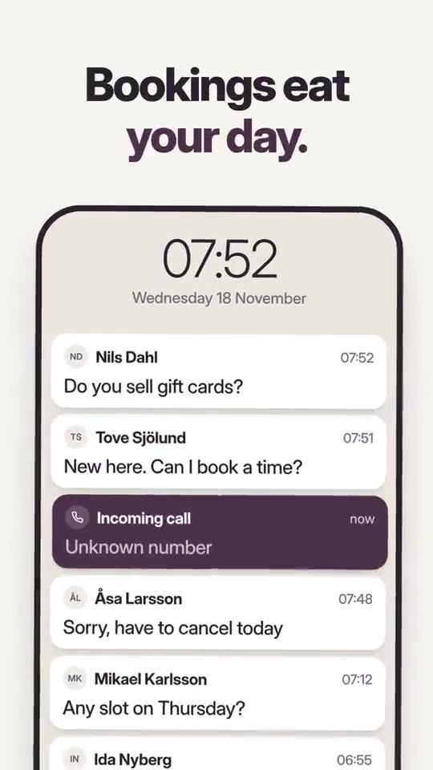
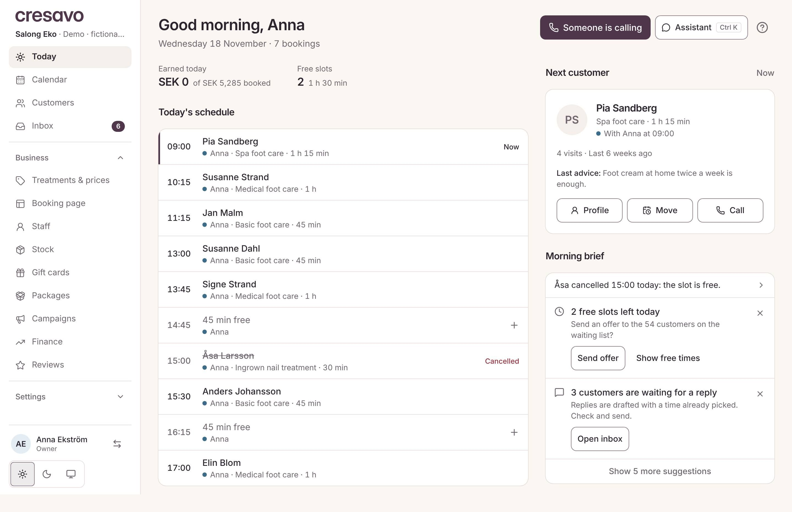
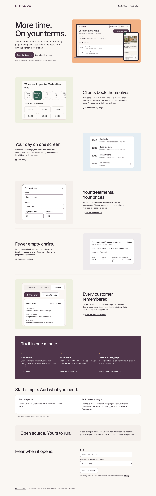

# Cresavo

**More time. On your terms.**

[](LICENSE)
[](https://github.com/niclasvestlund-YT/booking-lab-se/actions/workflows/verify.yml)
[](https://github.com/niclasvestlund-YT/booking-lab-se/actions/workflows/secret-scan.yml)

Cresavo is a calm, open-source booking and business workspace for small
service businesses, starting with salons and clinics. Your calendar, your
customers and your booking page in one place. An optional assistant can
suggest the next step, but you approve every change, and everything works
with plain buttons and no AI at all.

> **Status: concept demo; work in progress; not production-ready.** The demo
> runs on fictional data in your browser. Do not use it with real customers
> yet; see [STATUS](docs/STATUS.md) and [QUALITY_SECURITY](docs/QUALITY_SECURITY.md).

- **Live demo:** <https://demo.cresavo.com> (fictional salon "Salong Eko", no sign-up)
- **Tour video (36 s, silent):** [watch the tour](docs/media/cresavo-tour-9x16.mp4)

<a href="docs/media/cresavo-tour-9x16.mp4"></a>

## Screenshots

| The owner's day | Dark mode |
|---|---|
|  |  |

| Landing page | Customer booking page (mobile) |
|---|---|
|  |  |

## Features

- **Today:** the day's schedule, the next customer and free slots at a glance;
  book a caller in a few taps ("Someone is calling").
- **Calendar:** drag a visit to move it; opening hours and lunch breaks per business.
- **Customers and journal:** visit history, preferences and treatment notes.
- **Inbox:** booking requests, cancellations and reviews, with drafted replies
  you check before sending.
- **Booking page:** each business gets its own page with treatments, team,
  hours and reviews; clients book, move and cancel themselves.
- **Treatments and prices, campaigns, gift cards, packages, stock and finance**
  as modules you switch on when you need them.
- **Undo and "What happened?":** changes are logged, and a change can be
  undone as long as nothing later stands in the way (for example a new booking
  in the same slot).
- **Your data is yours:** export it, connect other tools through an open API
  and an MCP endpoint, or host it yourself.
- **AI is optional:** bring your own key for OpenRouter, OpenAI or Anthropic;
  without a key every task runs built-in rules.

## Quick start

Requires Node.js 22.12+ (or 24+).

```bash
git clone https://github.com/niclasvestlund-YT/booking-lab-se.git cresavo
cd cresavo
npm run demo        # installs dependencies and opens the studio
```

Open <http://localhost:3000/studio> (owner) and
<http://localhost:3000/boka/salong-eko> (customer booking page). Demo state
lives in your browser; **More → Settings → Reset demo** starts over. On
Windows you can also double-click `start-demo.cmd`. Optional AI: set
`OPENROUTER_API_KEY`, `OPENAI_API_KEY` or `ANTHROPIC_API_KEY` in `.env`.

## Self-hosting

- **Concept demo:** a plain Next.js app with no database or secrets. Build it
  the way the public demo is built (the database URL is a placeholder that is
  only needed to generate the Prisma client):

  ```bash
  npm ci && npx prisma generate
  DATABASE_URL=postgresql://build@127.0.0.1:1/build_test \
  NEXT_PUBLIC_CONCEPT_PUBLIC_DEMO=1 NEXT_PUBLIC_CONCEPT_PRODUCT_DOMAIN=your-domain.example \
  npm run build
  npm start                      # http://localhost:3000
  ```

  To deploy on Vercel, see [DEPLOY_DEMO](docs/DEPLOY_DEMO.md) and change the
  product domain in `vercel.json` to one you control.
- **Booking engine** (`/admin`, `/api/v1`, owner MCP): needs PostgreSQL. With
  Docker Compose:

  ```bash
  cp -n .env.example .env        # set SESSION_SECRET (at least 32 random characters)
  docker compose up -d --wait
  npm ci && npx prisma generate
  npm run db:migrate && npm run db:seed
  npm run admin:manage -- create admin@example.test
  npm run dev                    # use the npm scripts, not next dev directly
  ```

  The owner MCP is local only: `npm run mcp:client` (read-only) or
  `npm run mcp:client -- --admin --workspace` (every write asks for "yes").

The booking engine is a tested proof of concept with synthetic data, not a
hardened production service.

## Architecture

- **Next.js 16 + TypeScript.** The concept demo (`src/app/studio`,
  `src/app/boka`, `src/concept/`) runs on fixture data and browser state;
  `src/proxy.ts` routes the product domain, the demo subdomain and business
  addresses.
- **Booking engine:** Prisma and PostgreSQL. Booking rules live once in
  `src/lib/domain.ts` and are shared by the web, the REST API and the MCP.
- **Agent gateway:** the public REST/MCP entry for external agents lives in a
  separate repository, `booking-lab-gateway`, which is not public yet
  (contract: [GATEWAY_SPLIT](docs/GATEWAY_SPLIT.md)).
- More: [ARCHITECTURE](docs/ARCHITECTURE.md), [DATA_FLOWS](docs/DATA_FLOWS.md),
  [PRIVACY_SECURITY](docs/PRIVACY_SECURITY.md), [ROADMAP](docs/ROADMAP.md),
  [CHANGELOG](CHANGELOG.md). Some engine docs are still in Swedish; moving
  them to English is planned.

## Checks

```bash
npm run lint && npx tsc --noEmit && npm test && npm run build
npm run test:concept           # concept demo browser tests (Playwright)
npm run test:integration       # needs a local database whose name ends in _test
```

## Contributing

Contributions are welcome. Read [CONTRIBUTING](CONTRIBUTING.md) and
[AGENTS.md](AGENTS.md) (how we work; it applies to people and AI agents
alike). Pull requests need the [Contributor License Agreement](docs/legal/CLA.md)
(individual or entity), confirmed through the CLA Assistant bot. Please follow
the [Code of Conduct](CODE_OF_CONDUCT.md).

## Security

Report vulnerabilities privately through GitHub Security Advisories, never in
a public issue. See [SECURITY](SECURITY.md).

## Licence and trademark

The source code is licensed under the
[GNU Affero General Public License v3.0 only](LICENSE) (AGPL-3.0-only).
If you run a modified version as a network service, the AGPL requires you to
offer its users the corresponding source. Third-party components keep their
own licences: [THIRD_PARTY_NOTICES](THIRD_PARTY_NOTICES.md).

**Not covered by the AGPL:** the Cresavo name, wordmark and symbol concepts,
the brand kits in `design/brand/**` (except the token files the build needs),
the app icons in `public/brand/**` and the media in `docs/media/**`. All
rights in them are reserved; see [TRADEMARK.md](TRADEMARK.md) for what you may
do. Forks must use their own name and logo.
