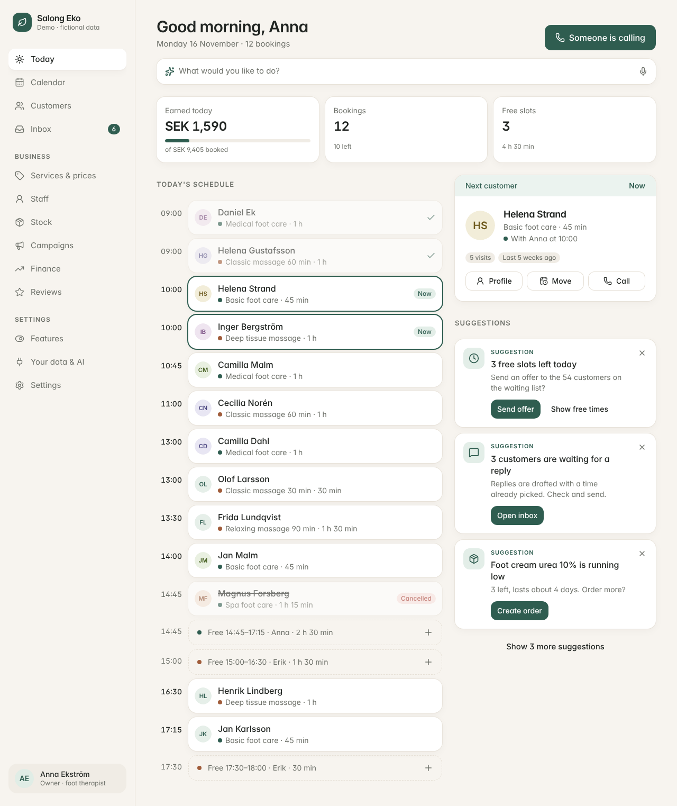

# Flerdo

**Do more, click less.** An AI-native system for small service businesses –
starting with salons – where you say what you want and approve the proposal.
Everything also works with plain buttons, and AI is never required.

> **Status: concept demo (0.x).** The studio and customer pages run on
> fictional data in your browser. The booking engine underneath is a tested
> proof of concept. Nothing here is ready for real customers yet – see
> [what that takes](docs/QUALITY_SECURITY.md).



## Why

Running a small salon means juggling the phone, the calendar, stock,
marketing and bookkeeping – usually across several tools that each want
their own clicks. And the data you create there is hard to get back out.

Flerdo is built around three ideas:

1. **Say it instead of clicking.** "Move Anna's 2 pm to Friday", "20% off
   massage all of March", "order more foot cream". Flerdo shows exactly what
   will change; you approve with one tap, and you can undo.
2. **Proactive, not passive.** Free slots to fill, stock running low,
   customers due back, holidays coming up – the system tells you, with a
   suggested next step.
3. **You own your data.** Everything is readable through open protocols
   (MCP, A2A, USP) and exportable, so you can ask Claude or ChatGPT for any
   report you like. No paid API tier to get your own data.

## What works today

| Area | Status |
|---|---|
| Owner studio: Today, Calendar, Customers, Inbox | **Working** (demo data) |
| Command box and voice ("Ask Flerdo"), proposals with approve/undo | **Working** (rules; AI when a key is set) |
| Customer booking page with free-text search, My bookings, waiting list | **Working** (demo data) |
| Customer cards, voice journal, return-visit reminders, segments | **Working** (demo data) |
| Campaign studio: texts per channel, posters, simulated publishing and ads | **Working** (simulated channels) |
| Stock: consumption per treatment, forecasts, purchase lists, deliveries | **Working** (demo data) |
| Finance overview, costs, SIE/CSV export, bookkeeping connection | **Working** (simulated connection) |
| Activity log with undo, trash, in-app help, support tickets | **Working** |
| Modules you switch on and pay for, industry packs, onboarding | **Working** |
| AI layer: task agents, model router, bring your own key, evals | **In progress** |
| Open protocols for the studio (MCP, A2A, USP) | **In progress** |
| Real database for the studio, real messaging and payments | **Planned** |

More screenshots: [command box](docs/concept/screens/command-move-1280.png) ·
[customer booking](docs/concept/screens/booking-suggest-1280.png) ·
[customer card](docs/concept/screens/customers-card-1280.png) ·
[campaign poster](docs/concept/screens/campaign-3-poster-1280.png) ·
[finance](docs/concept/screens/finance-1280.png) ·
[modules](docs/concept/screens/modules-features-1280.png) ·
[activity log](docs/concept/screens/support-log-1280.png) ·
[everything](docs/concept/screens/).

## Try it

Requires Node.js 22+.

```bash
npm ci
cp .env.example .env
npm run dev
```

Open <http://localhost:3000/studio> (owner) and
<http://localhost:3000/boka/salong-eko> (customer). The studio keeps its demo
state in your browser; **More → Settings → Reset demo** starts over.

Optional AI: set `OPENROUTER_API_KEY`, `OPENAI_API_KEY` or
`ANTHROPIC_API_KEY` in `.env`. Without a key every task runs its built-in
rules. `npm run ai:eval` checks the AI tasks against fixed scenarios.

The underlying booking engine (admin, agent API, MCP) needs PostgreSQL:

```bash
docker compose up -d
npx prisma generate
npm run db:migrate
npm run db:seed
```

## How it is built

- **Headless core.** Every action is a typed tool. Buttons, the command box,
  voice, scheduled agents and external AIs all call the same tools.
- **One agent per task.** Small specialists (interpret a command, structure a
  journal, write a post, forecast stock…) each with a schema, a model tier
  and a rule fallback. Better models make Flerdo better by changing one table.
- **AI only proposes.** Nothing changes without a human yes, and every change
  is logged with who, what and how to undo it.
- **Open protocols** as thin adapters, so the product improves as the
  standards do. See [the concept](docs/concept/CONCEPT.md).

Next.js 16, React 19, TypeScript, Tailwind, Prisma/PostgreSQL, Vitest,
Playwright.

## Roadmap and progress

- [Concept](docs/concept/CONCEPT.md) – the full idea
- [Goal queue](docs/goals/QUEUE.md) – what is being built, in order
- [Progress log](docs/concept/PROGRESS.md) – what changed, with screenshots
- [Changelog](CHANGELOG.md)

## Contributing

Contributions will be welcome once the repository is public. Every
contributor will sign a contributor licence agreement once, before the first
pull request is merged. Read [AGENTS.md](AGENTS.md) for how we work –
it applies to people as much as to AI agents.

## Licence

[AGPL-3.0-only](LICENSE). Earlier project history and the previous README are
kept in [docs/history](docs/history/).
