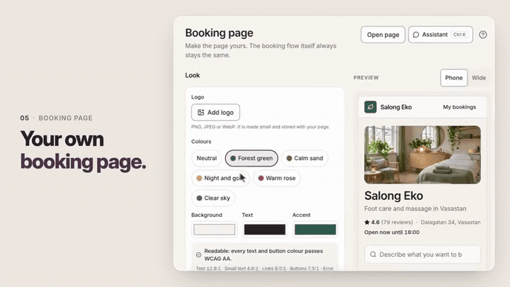
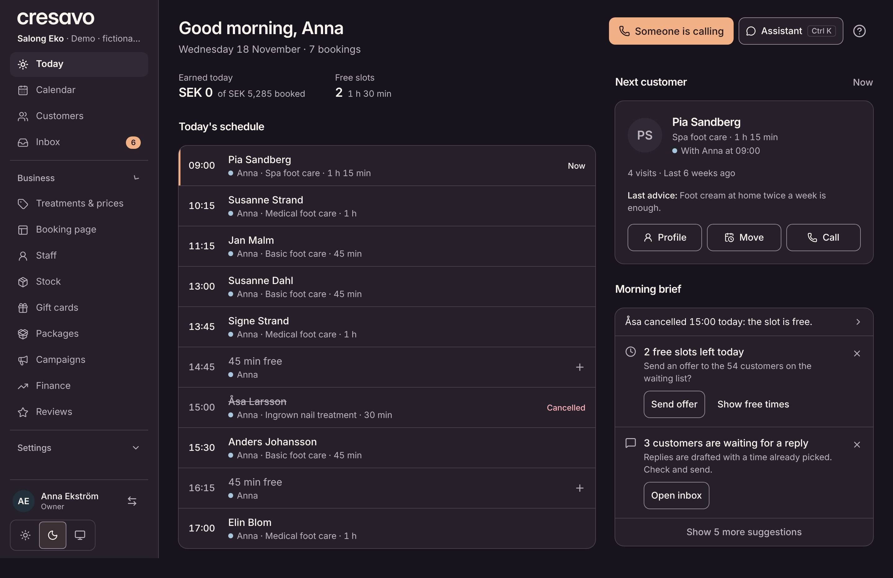
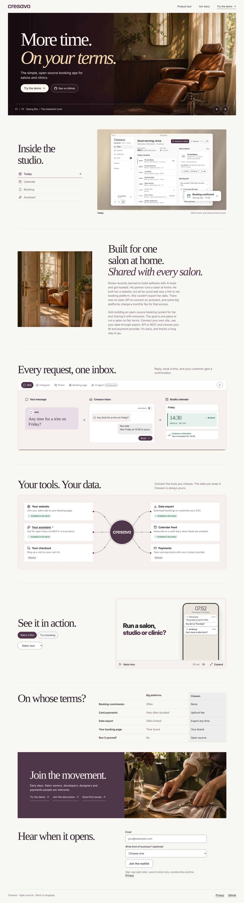
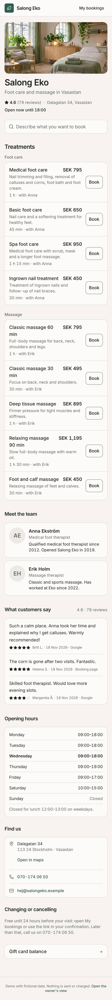

# Cresavo

<picture>
  <source media="(prefers-color-scheme: dark)" srcset="design/concepts/logo-v3-codex/selected-inter-regular/wordmark-white.svg">
  
</picture>

**More time. On your terms.**

Cresavo is an open-source booking app for salons and clinics that brings appointments, clients and daily operations together.

[](https://github.com/Cresavo/cresavo/actions/workflows/verify.yml)
[](LICENSE)
[](https://demo.cresavo.com/studio)

> **Early concept demo.** Use fictional data only. Cresavo is still being built and is not ready for real customers. See [project status](docs/STATUS.md).

[](https://cresavo.com/site/tour-16x9.mp4)

[Try the demo](https://demo.cresavo.com/studio) · [Watch the 36-second tour](https://cresavo.com/site/tour-16x9.mp4) · [Join Discussions](https://github.com/Cresavo/cresavo/discussions) · [Roadmap](docs/ROADMAP.md) · [Releases](https://github.com/Cresavo/cresavo/releases)

## Why Cresavo

Niclas started building Cresavo for his partner, who runs a salon at home.
He learned to build software with AI coding tools and made her a website
that could only link out to her booking page. Her platform handles appointments,
but she can't export her data or connect the tools she wants to use. He's
building an open-source booking app where salon owners can take their data
with them, connect their own website or AI assistant, and choose their
checkout and payment tools. If you run a salon or work in software, design
or payments, he'd love your help making booking software fairer.

## Quick start

Requires Git and Node.js 22.12+ or 24+.

```bash
git clone https://github.com/Cresavo/cresavo.git
cd cresavo
npm run demo
```

Open the [owner studio](http://localhost:3000/studio) and the [customer booking page](http://localhost:3000/boka/salong-eko).
The demo saves changes in your browser. Use **More → Settings → Reset demo**
to start over. On Windows, the [demo launcher](scripts/windows/start-demo.cmd)
tries a fast-forward update before starting the local demo.

## Features

- **Today** shows the day’s schedule, the next customer and free slots.
  Use “Someone is calling” to book a caller in a few taps.
- **Calendar** supports drag-to-reschedule, opening hours and lunch breaks.
- **Customers and journal** keep visit history, preferences and treatment notes together.
- **Inbox** collects booking requests, cancellations and reviews. Review
  drafted replies before sending.
- **Booking pages** show treatments, staff, hours and reviews under the
  business’s own brand. Clients can book, reschedule and cancel.
- **Treatments and prices, campaigns, gift cards & packages, stock and finance**
  as modules you switch on when you need them.
- **Undo and activity history** let owners see what changed and undo actions
  when later changes still allow it.
- **Data export and open interfaces** let owners download data or connect
  tools through the project’s API or MCP.
- **AI is optional.** Try the built-in rules or bring your own key for
  OpenRouter, OpenAI or Anthropic.

| The owner's day | Dark mode |
|---|---|
|  |  |

| Landing page | Customer booking page (mobile) |
|---|---|
|  |  |

## Self-hosting

- **Concept demo:** a plain Next.js app with no database or secrets. Build it
  with a placeholder database URL for the build tooling.

  ```bash
  npm ci
  export DATABASE_URL=postgresql://build@127.0.0.1:1/build_test
  npx prisma generate
  NEXT_PUBLIC_CONCEPT_PUBLIC_DEMO=1 NEXT_PUBLIC_CONCEPT_PRODUCT_DOMAIN=your-domain.example npm run build
  PUBLIC_READONLY=1 npm start
  ```

  To deploy on Vercel, see [DEPLOY_DEMO](docs/DEPLOY_DEMO.md) and change the
  product domain in `vercel.json` to one you control.
- **Booking engine** (`/admin`, `/api/v1`, owner MCP): needs PostgreSQL. With
  Docker Compose:

  ```bash
  cp -n .env.example .env        # set SESSION_SECRET (at least 32 random characters)
  docker compose up -d --wait
  npm ci && npx prisma generate
  npm run db:migrate && npm run db:seed
  npm run admin:manage -- create admin@example.test
  npm run dev                    # use the npm scripts, not next dev directly
  ```

## Architecture

- **Next.js 16 and TypeScript** power the concept demo. It runs on fixture
  data and browser state. Host routing serves the product site, demo and
  business booking pages.
- **Booking engine:** Prisma and PostgreSQL. Booking rules live once in
  `src/lib/domain.ts` and are shared by the web, the REST API and the MCP.
- **Agent gateway:** the public REST/MCP entry for external agents lives in a
  separate repository, `booking-lab-gateway`, which is not public yet
  (contract: [GATEWAY_SPLIT](docs/GATEWAY_SPLIT.md)).
[Architecture](docs/ARCHITECTURE.md) · [Data flows](docs/DATA_FLOWS.md) ·
[Privacy and security](docs/PRIVACY_SECURITY.md) · [Changelog](CHANGELOG.md)

## Connect your AI assistant

Use the local owner MCP to look up treatments and open times from a fictional
PostgreSQL database. Run `npm run mcp:client` for read-only access or
`npm run mcp:client -- --admin --workspace` for the approval walkthrough.
The local concept server also demonstrates proposals you can review in the
studio Inbox. [Connect your AI assistant](docs/CONNECT_AI_ASSISTANT.md).

## Testing

```bash
npm run lint && npx tsc --noEmit && npm test && npm run build
npm run test:concept           # concept demo browser tests (Playwright)
npm run test:integration       # needs a local database whose name ends in _test
```

## Contributing

Contributions are welcome. Browse [good first issues](https://github.com/Cresavo/cresavo/issues?q=is%3Aissue+is%3Aopen+label%3A%22good+first+issue%22),
read the [contribution guide](CONTRIBUTING.md) and follow the [Code of Conduct](CODE_OF_CONDUCT.md).

Contributions will need a [Contributor License Agreement](docs/legal/CLA.md)
(individual or entity). It is a **draft, pending legal review**, and the
project is not collecting signatures yet: you are welcome to open issues and
pull requests and to comment on the draft, but external pull requests are held
for merge until the reviewed signing process is available.

## Security

Report vulnerabilities privately through GitHub Security Advisories, never in
a public issue. See [SECURITY](SECURITY.md).

## Licence and trademark

The source code is licensed under the
[GNU Affero General Public License v3.0 only](LICENSE) (AGPL-3.0-only),
including the design-token files and artwork the application needs to build
and run. If you modify Cresavo and users interact with it over a network,
prominently offer those users a free download of the Corresponding Source of
the version they are using, including the files and scripts needed to build
and run it. Third-party components keep their own licences:
[THIRD_PARTY_NOTICES](THIRD_PARTY_NOTICES.md).

**Not covered by the AGPL:** trademark rights in the Cresavo name and logo,
the standalone brand kits in `design/brand/**` (except the token files the
build needs) and the media in `docs/media/**`; all rights in those are
reserved. You may fork the repository, keep its attribution and say truthfully
that your work is based on Cresavo. Use a distinct name and logo for an
independently offered modified product or service, and do not suggest it is
official. Details: [TRADEMARK.md](TRADEMARK.md) (draft, pending legal review).
