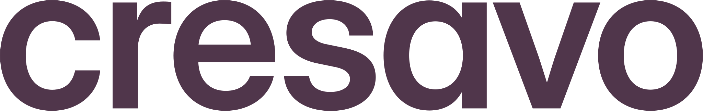

# Cresavo · Brand concept v0.1

<picture>
  <source media="(prefers-color-scheme: dark)" srcset="wordmark/cresavo-wordmark-dark.svg">
  
</picture>

**More time. On your terms.**

Cresavo is the workspace behind a small service business. Picture the moment between two appointments. Someone calls, the owner finds a time, and the next customer already has their coat off. The measure of the product is how quickly the owner can give that person their full attention again. That is the story to tell on cresavo.com.

Bookings, customers, staff, finances, marketing, messages and workflows belong to the same business day. Use the language of each business. A salon has treatments, a clinic has visits, and both have a calendar. Keep product areas plainly named, such as Calendar, Inbox and Finance.

## The name

**Cresavo** is coined. Use title case in speech transcripts, prose, page titles and accessible names. The artwork is lowercase. Suggested English pronunciation is *kreh-SAH-voh*. Test what people hear and type in each launch language.

- **Room to grow** is the preferred internal story. The opening can bring “crescendo” to mind. Growth here can mean keeping the same number of appointments and getting an evening back. This is a sound association, with no claim of linguistic origin.
- **An open day** is a visual reading. The word starts with the open bowl of a c and ends with a complete o. In a schedule, an opening is a choice. The owner can fill it or keep it free. This reading informs the lettering and the way we show available time.

## The promise in English

| Line | Use |
| --- | --- |
| **More time. On your terms.** | Pick for site hero and product welcome. “On your terms” gives the Swedish “Dina villkor” its idiomatic English meaning. Keep both full stops. |
| More time for the work you choose. | Alternative for an owner interview or campaign about choosing which work to take on. |

Use the chosen line once on arrival. Inside the studio, give its space to the next appointment, a customer name or a decision.

## Personality in practice

| Value | Do | Avoid |
| --- | --- | --- |
| Freedom | Put “Export your data” next to the data it acts on. Show what the file contains. | Making an owner contact sales to understand their options. |
| Simplicity | On the phone, show one person's day with the staff switch in reach. Give the screen one filled primary action. | A dashboard of equally emphatic actions. |
| Time | Lead with the opening itself. “14:30 · 45 min free” can be read during a call. | Percentages saved without a measured basis. |
| Openness | Name the connection, what it can read or change, and its status. Reserve terms such as API and MCP for connection settings and developer pages. | Presenting a planned integration as connected. |
| Proactivity | State the reason and leave a choice. “A cancellation opened 45 minutes. Review waiting list.” | Sending a message because a slot became free. |

The voice is composed, observant and specific. Sentence case, active verbs, ordinary nouns. Preserve the business owner's name for a service. Address the person directly. After an error, tell them what they can do next.

## Colour and form

**Keep the Libovo aubergine/apricot palette and Inter.** In the Today screenshots the dark aubergine action is easy to find on the warm canvas. In the dark Calendar the apricot action holds its place among staff colours. Owners can recognise the same control tomorrow. The new name earns a new drawing of the word. It gives us no reason to change how a time column reads.

| Role | Light | Dark |
| --- | --- | --- |
| Canvas / surface | `#FAF7F3` / `#FFFFFF` | `#18141E` / `#25202A` |
| Body / supporting text | `#2C242E` / `#6F666F` | `#FBF5F0` / `#BEB4BD` |
| Main action / its label | `#50364B` / `#FFFFFF` | `#F2B184` / `#211820` |
| Divider / control outline | `#8E8289` / `#897885` | `#897F8B` / `#9B8C9C` |

The colour correction is the divider. Libovo's decorative line was too faint for a meaningful boundary. Cresavo's divider clears 3:1 even on tinted panels. Use a single 1 px rule where adjoining groups need it. On an otherwise open page, separate groups with space. Keep 10 px corners on controls and 14 px on sheets. Reserve pills for filters and compact status labels. Use flat, opaque surfaces and set text directly on them. Avoid glass, gradients, neon, ornamental frames and grids of decorative cards.

**Give time its own column.** On schedule previews, set a tabular time on a common left edge, then align the person's name and service in a second column. An open slot gets the same space and type size as a booked slot. On the site, give each sentence of the promise its own line when space allows. This quiet, recurring rhythm carries the identity even where a logo would be in the way.

## How the assistant appears

Use **Ask Cresavo** as the proposed studio action. Keep the name in the existing assistant dictionary/configuration entry so the owner can approve the change from “Ask Flerdo”. On desktop it is a secondary header action with the existing keyboard shortcut. On mobile it is a labelled compact launcher clear of the tab bar. Keep ordinary booking and search controls available with assistance switched off.

A cancellation appears in Today as “A 45-minute slot opened at 14:30.” The next action is “Review waiting list”. If the owner asks to draft an offer, label it **Proposal**, name the intended recipients, show the draft, and offer Edit, Approve and Dismiss. Approval in the demo records a simulated action. Show Undo only while the change can actually be reversed. Reserve “AI” for where it helps someone decide, such as enabling a provider or understanding how a draft was made.

## Platform and tenant

Cresavo owns the studio, platform settings, sign-in and both marketing domains. The salon owns the experience from the first paint of its public booking page through confirmation, gift cards, widget and My bookings. Salong Eko keeps its forest green, name and photography. Use neutral ink and paper when a tenant has no palette. Match browser chrome and metadata to the tenant. An embed is titled “Book with Salong Eko”. Platform attribution stays off by default.

The public route boundary controls the whole canvas, including unknown addresses and errors. The tenant follows its own palette or the visitor's system preference. Resolve protected success, warning, danger and info on their paired grounds in that local scheme. Keep staff identity separate too, and always print the person's name.

## Implementation handoff

- **Tokens.** Replace the platform token sheet at its existing import point. The CSS preserves the predecessor's custom-property names, spacing, radii, tenant hooks and the six studio extension names. Keep the tenant theme layer and existing theme preference handling in place. The JSON retains the old light/dark key sets, with the six extra colours under `extensions`. Point the existing parity test and browser-chrome JSON consumer at the new kit during adoption. [Stylesheet](tokens/cresavo.tokens.css) · [Colour values](tokens/colors.json)
- **Approved pairings.** The report identifies allowed grounds for each use, including pressed buttons, secondary and disabled labels, strokes, status fills and staff tints. Use opaque colours at full strength. On danger buttons use the solid danger stroke when the boundary identifies the control. Place a 2 px focus ring 2 px outside the control so it meets the surrounding ground. Give links an underline and chart comparisons a dash or outline. Recheck rendered components when opacity, imagery or tenant customisation changes their actual colours. [Measured contrast](tokens/contrast-checks.json)
- **Lettering and type.** The four wordmarks are outlined and share one drawing. Only the small c icon is a temporary symbol. [Wordmark master and placement](wordmark/README.md) · [Typography](typography.md)
- **Site and release.** Both page specs provide the English strings for their area dictionaries. [Coming soon](site/coming-soon.md) · [Demo landing](site/landing.md) · [Public launch checklist](CHECKLIST.md)
