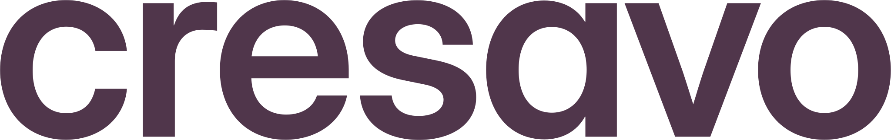

# The cresavo wordmark

One low line of seven letters. The opening c, the single-storey a and the closing o share a bowl shape. The v makes a small cut in that sequence, still legible at the width of a mobile header. Capitalise Cresavo in ordinary text and accessible names.

## Drawing

Master from **Inter Display SemiBold, 600 upright**, static Inter Display 4.0, 2048 units per em. Set lowercase `cresavo`, kerning on, with OpenType `cv11` for the single-storey a. Apply −0.022 em tracking between letters. The following adjustments are additional to the shaped pair and tracking. They tighten the open diagonal pairs and give the two curved letters in the middle a little air.

| Pair | Optical adjustment |
| --- | --- |
| cr | 0 |
| re | −0.008 em |
| es | +0.006 em |
| sa | 0 |
| av | −0.012 em |
| vo | −0.010 em |

The supplied vectors are the master. Each file contains the same seven filled glyph paths and a tight 6992 × 1107 viewBox. Keep the native aspect ratio and scale uniformly. The outlines are self-contained and require no font download. [Source typeface](https://rsms.me/inter/)

## Placement and colour

| Asset | Ink | Intended ground |
| --- | --- | --- |
| [Light](cresavo-wordmark-light.svg) | Aubergine `#50364B` | Light canvas or white surface |
| [Dark](cresavo-wordmark-dark.svg) | Warm white `#FBF5F0` | Dark canvas or dark surface |
| [Black](cresavo-wordmark-black.svg) | `#000000` | Single-ink print or white ground |
| [White](cresavo-wordmark-white.svg) | `#FFFFFF` | Black or fixed aubergine ground |

- Let **x** be the visible height of the final o. Keep at least **½x** clear on all four sides, measured from the ink. Use a full x on marketing pages where space permits. Padding lives in the layout outside the SVG.
- Minimum width **96 CSS px** on screen or **25 mm** in print. Set 112 px in the phone bar and 124 px in the desktop sidebar. At 112 px wide the ink is about 18 px high. Centre it inside a 44 px or taller link. Match the left ink edge to the page's text column.
- The marketing masthead uses 144 px on phones and 176 px on wide screens. Place the promise in its own text element. Leave the wordmark as a single ink shape on a solid ground.
- As a linked image, use `alt="Cresavo home"` or the actual destination. When surrounding link text already names the destination, use empty alt. Inline stand-alone art carries its own accessible name.
- The [temporary c monogram](../icons/monogram-placeholder.svg) is a crop of the first letter, white on aubergine, for internal icon slots. Use the full wordmark for the masthead. Final symbol and small-size production exports need sign-off.
