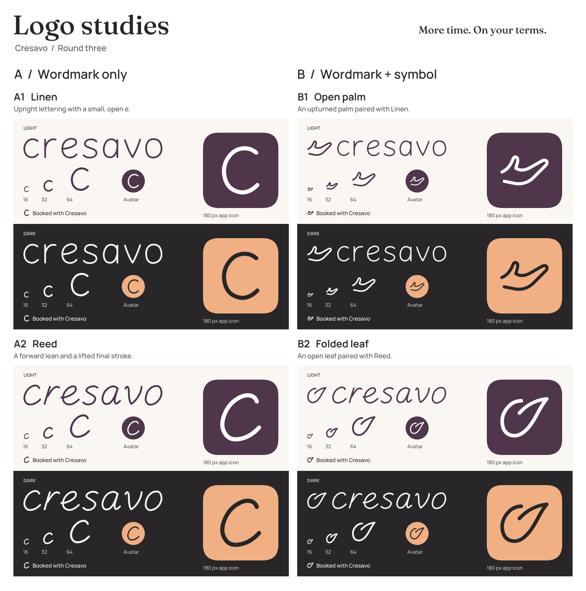

# Cresavo identity · selected artwork

**Cresavo** is set in [Inter Regular](https://github.com/rsms/inter) (400), with a capital C and the remaining letters lowercase. The app icon keeps the previously selected white lowercase c on aubergine (`#4f364b`) in both colour schemes.

[Aubergine wordmark](selected-inter-regular/wordmark.svg) · [Black wordmark](selected-inter-regular/wordmark-black.svg) · [White wordmark](selected-inter-regular/wordmark-white.svg) · [App icon for both modes](selected-inter-regular/app-icon.svg) · [Round avatar](selected-inter-regular/avatar.svg)

[View the contact sheet at full size](contact-sheet.svg). The first two panels show the selected artwork in light and dark mode. The wordmark uses outlines from the site's Inter font with the spacing from the header preview (−0.035 em). Inter is licensed under the [SIL Open Font License 1.1](https://github.com/rsms/inter/blob/master/LICENSE.txt).

## Earlier directions

[Compare the original drawings and the two refinements](refinements.svg).

| Direction | What to look for | Trade-off |
| --- | --- | --- |
| [A1 · Linen](a1-linen/) | Upright, rounded letters. The open e and generous spacing make the name easy to pick out in a booking footer. | The isolated c has the least individual character. |
| [A2 · Reed](a2-reed/) | Slightly slanted letters with a lifting exit on the a. The favicon uses the exact opening c with a small-size weight adjustment. | Some of the difference between the two c shapes disappears at 16 px. |
| [B1 · Open palm](b1-open-palm/) | A continuous line turns from the thumb into a cupped palm beside Linen. The gesture refers to the person doing the work. | At 16 px the gesture can also read as a bird in flight. |
| [B2 · Folded leaf](b2-folded-leaf/) | An open outline bends back into a leaf beside Reed. The gap and the inner line remain visible in the app icon. | The leaf suggests wellness more directly than the other marks. |

## What changed in review

1. **First refinement.** The original upright lettering felt crowded around the e. We lightened the line, lifted the e crossbar and opened the spacing. Reed's r had a doubled-back shoulder that looked like a dark knot. Redrawing the shoulder as a clean branch removed it. In the palm we took out a small hooked return.
2. **Second refinement.** The simplified palm still looked like two nested curves. We lifted the thumb and opened the wrist. The leaf's outer edge met its inner fold when reduced, so we shortened the upper contour. We adjusted Linen's opening c and widened the small-size outlines in all four directions. The contact sheet uses these optical versions at 16 and 32 px. The 64 px and 180 px examples show the lighter display outline.

## Reading the earlier studies

Each folder contains a horizontal wordmark or symbol pairing in aubergine, solid black and solid white, a standalone mark, a favicon, and square app and round avatar artwork for light and dark settings. The favicon responds to the device's colour scheme. The app artwork is drawn at 180 px and scales as vector artwork. The tiny footer examples use the exact line “Booked with Cresavo”.

The light grounds use warm neutral **#faf7f3** with aubergine **#4f364b** lettering. The dark panels use near-white lettering on charcoal. Apricot **#f0b084** appears in the alternate icon studies and the round avatar samples. All artwork, including the lettering in the contact sheet, is made of closed SVG paths. The two wordmarks were drawn for these studies. Specimen labels use outlines from [Manrope](https://github.com/google/fonts/tree/main/ofl/manrope) and [Fraunces](https://github.com/google/fonts/tree/main/ofl/fraunces).
