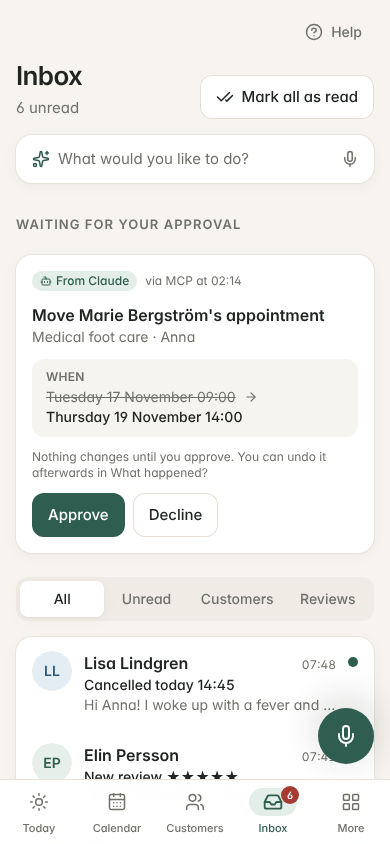
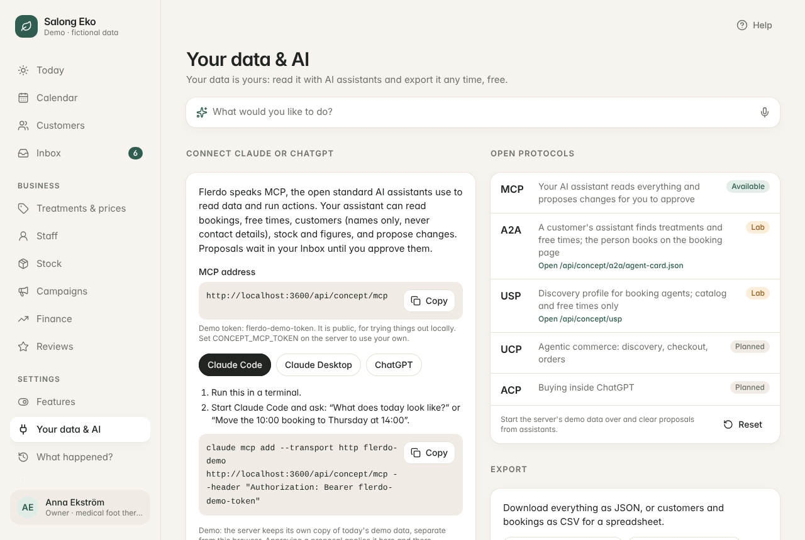
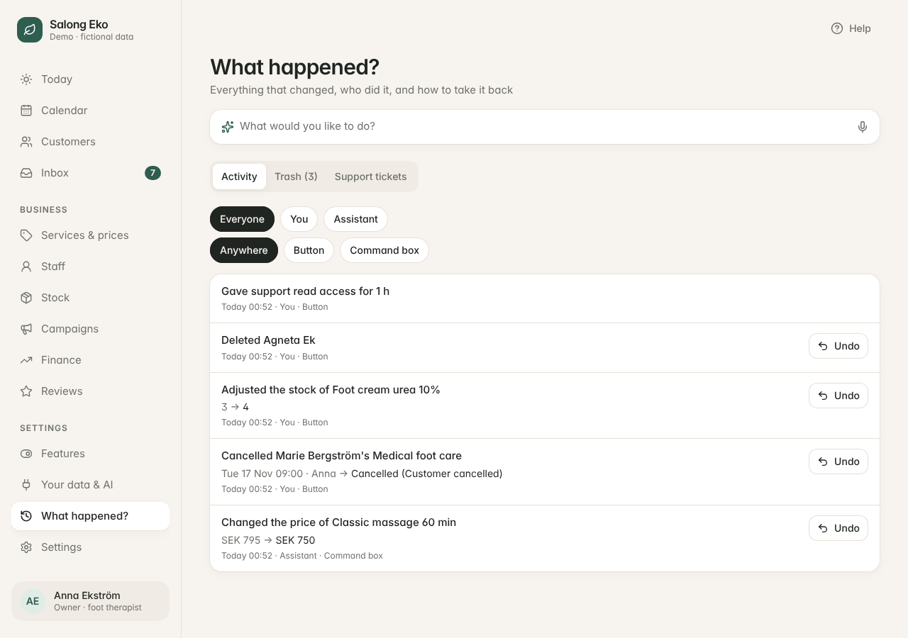
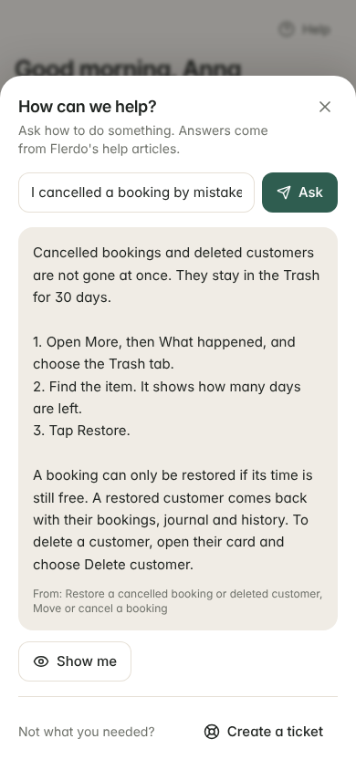

# Progress · AI-native demo

## 2026-11-17 · Codex · night 3 part 1: finding #12

Compatible TypeScript-ESLint 8.73.0 now supports fixed minimatch 11.x. Full and production-only npm audits report zero vulnerabilities. No direct ranges, overrides, prereleases or toolchain major upgrades were introduced. See [dependency review](../DEPENDENCY_REVIEW.md).

**Part 1 validation**: lint, tsc, 984 unit tests, 211 engine integration tests, production build and 49/49 offline AI evals pass. UI checked at 390/1280 px with mocked speech support. #14 remains open; goals 11/12 were not started.

## 2026-11-17 · Codex · night 3 part 1: finding #15

The engine MCP handler is created once per process. Its SDK factory receives only the freshly authenticated request principal; no client credentials are cached or shared. Auth, request-size limit, rate limit, scopes, read-only policy, mandates and idempotency remain enforced. Concurrent real-SDK transport tests and all 211 engine integration tests pass. Try the existing `/api/v1/mcp` tools with separate demo clients.

## 2026-11-17 · Codex · night 3 part 1: finding #13

The shared time parser prefers complete clock tokens before bare-hour prefixes. Regression cases cover at/to/weekday, am/pm, invalid clocks and a move to 14:30; the customer wrapper now uses the shared parser. Try “Move Anna’s appointment on Thursday to 14:30” in the command box.

## 2026-11-17 · Codex · night 3 part 1: finding #16

Mobile command input says “Ask Flerdo…”. The redundant floating microphone is removed; inline speech and typed fallback remain, so no floating mic can cover a button. Try `/studio` at 390/1280 px. Screenshots: [mobile](screens/polish-command-390.png), [desktop](screens/polish-command-1280.png).

## 2026-11-17 · Claude Code · goal 13 (in-repo part): Flerdo rename and front door

**Done**

- Product renamed to Flerdo in user-facing text: landing `/`, root metadata,
  `/product`, `/live`, admin header, A2A agent card name, command box
  placeholder ("Ask Flerdo… what would you like to do?"). The concept UI and
  help articles already said Flerdo.
- Front door: CONTRIBUTING, CODE_OF_CONDUCT, SECURITY, issue forms, PR
  template, draft CLA in `docs/legal/CLA.md`.
- `docs/OPEN_SOURCE_LAUNCH.md`: checklist, what needs Niclas, monorepo plan,
  and what was deliberately not renamed (engine identifiers, history, package
  name).

**Not done (needs Niclas)**: org, domains, npm scope, trademark, lawyer review,
GitHub security settings, CLA Assistant, visibility.

## 2026-11-17 · Claude Code (Opus) · goal 10: open protocols

**Done**

- **One tool registry** (`src/concept/tools/`): typed tools with zod inputs.
  Read tools: `get_business`, `list_bookings`, `get_availability`,
  `list_customers` (names and visit history only, never phone, e-mail,
  birthday, notes, tags or journal), `list_services`, `get_stock`,
  `get_finance`, `list_campaigns`. Write tools (`propose_booking`,
  `propose_move`, `propose_cancel`, `propose_price`, `propose_stock_order`,
  `propose_product_sale`) run the command box's own `proposalFor`, so slot
  checks, module switches and wording are shared; they only return a draft.
- **MCP endpoint** `/api/concept/mcp` (MCP SDK, stateless JSON, same pattern
  as `/api/v1/mcp`): bearer token from `CONCEPT_MCP_TOKEN` (outside production
  the public token `flerdo-demo-token` is used when unset; production refuses
  until it is set), 120 calls/min per token, the tool name in the structured
  log line, `idempotencyKey` required on every proposal (same key and
  arguments return the same proposal, other arguments are a conflict).
  `get_proposal` tells the agent the owner's decision.
- **Demo state, honestly split.** The studio's data lives in the browser. The
  server keeps its own copy of today's demo business in memory
  (`src/concept/server/demo-business.ts`, from the same deterministic
  generator, so ids match; lost on restart, regenerated each day, resettable
  from Your data & AI). Proposals wait there.
- **Inbox:** the studio polls `GET /api/concept/proposals`; proposals show at
  the top as *From Claude / From ChatGPT / From an AI agent* (from the
  User-Agent) with Approve and Decline. Approve runs the normal `dispatch`
  (actor Assistant, source MCP), so it is logged in What happened? with Undo,
  then tells the server, which applies the same action to its copy. If the
  browser's data has moved on, the studio says so and nothing changes.
- **A2A and USP:** agent card at `/api/concept/a2a/agent-card.json`, a minimal
  A2A 1.0 `SendMessage` endpoint (services, free times, and a booking page link:
  the person books themselves) and a USP discovery profile at
  `/api/concept/usp`. Both state what is not implemented.
- **More > Your data & AI:** status per protocol with links to the discovery
  documents, and copy-paste setup for Claude Code (`claude mcp add --transport
  http …`), Claude Desktop (via `mcp-remote`) and ChatGPT (honest: needs public
  HTTPS and OAuth, so not yet in this demo).
- Tests: `concept-tools.test.ts` (schemas, minimisation, write tools only
  draft), `concept-mcp.test.ts` (token, rate limit, MCP round trip with the SDK
  client, idempotency, approve/decline, A2A, discovery, setup snippets).

**Try it**

- `npm run dev`, then `npm run concept:mcp-demo` (lists today's bookings and
  proposes a move), open `/studio/inbox` and press Approve, then More > What
  happened?.
- Or `claude mcp add --transport http flerdo-demo http://localhost:3000/api/concept/mcp --header "Authorization: Bearer flerdo-demo-token"`.

**Remaining / limits**

- No owner login: the decision endpoint only checks same-origin (pilot gate).
- ChatGPT needs OAuth; the server copy and the browser copy can drift.

**Screenshots** (`docs/concept/screens/`): `protocols-inbox-*`,
`protocols-data-*`, `protocols-list-390`, `protocols-log-1280`.

## 2026-11-17 · Claude Code · goal 8: support, log and "What happened?"

**Done**

- **Activity log, captured centrally.** Every change goes through `dispatch()`
  in the store, which now runs `applyAction` (`src/concept/log/capture.ts`):
  the same pure reducer, then one log entry with who (you, colleague, assistant,
  customer, integration), what, before/after, source (button, command box,
  voice, booking page, campaign), time and what is needed to undo it. Pages
  never write log entries; a new action is logged and undoable without extra
  code. Reading a message or dismissing a card is not logged. Journal text and
  message bodies are never copied into the log.
- **More > What happened?** (`/studio/more/log`) with three tabs. *Activity*:
  newest first, filter by who and from where, **Undo** per entry while nothing
  has touched the same records since (an undo is a logged change of its own, so
  it can be undone again). *Trash* and *Support tickets* below.
- **Trash, 30 days.** Cancelled bookings and deleted customers (new **Delete
  customer** on the customer card, with confirm) wait in the Trash with "N days
  left" and **Restore**. A deleted customer takes bookings, journal, sales,
  reviews and inbox with them and gets them all back; a booking is restored only
  if its time is still free. Entries older than 30 days are dropped when the
  demo loads.
- **Help button** in the studio header: answers from 15 articles in
  `docs/help/*.md` through the new `answer-help` AI task (rules first: keyword,
  title and text match; an AI answer replaces it when a key exists; ids of
  unknown articles are ignored). Five common questions are one tap. **Show me**
  highlights the right button or menu item (going to the right page first, also
  on a phone). **Create a ticket** shows exactly what is attached: the page, a
  request id, a plain-text outline of the screen (headings and button labels,
  no typed text, standing in for a screenshot) and the last 20 changes; tickets
  are listed under *Support tickets*.
- **Support mode** in Settings: allow support read access for 1 hour or 24 hours,
  stop it any time; every grant and stop is logged and listed as access history.
- **Structured server logging** for `/api/concept/*` (`src/concept/server/logger.ts`):
  `x-request-id` on every response and one JSON line with request id, route
  pattern, method, status, duration and task name. The logger copies a fixed
  set of fields, so input text, keys and personal data cannot reach it.
- Demo data version 9 (`log`, `trash`, `supportGrants`, `tickets`).
- Tests: `tests/concept-log.test.ts` (capture, undo, stale refusal, redaction of
  journal text, filters), `concept-trash.test.ts` (cancel/restore, customer
  bundle, expiry), `concept-support.test.ts`, `concept-help.test.ts` (articles,
  fallback on 11 questions, screen outline), `concept-logger.test.ts`
  (redaction, request id). Eight help cases added to `npm run ai:eval` (40/40).

**Try it**

- Type "Set Classic massage 60 min to 750 SEK" in the command box, approve, then
  More > What happened? shows it as *Assistant · Command box* with Undo.
- Customer card > Delete customer, then What happened? > Trash > Restore.
- Help (top right) > "How do I undo a change?" > Show me. Then Create a ticket.
- More > Settings > Support access.

**Screenshots** (`docs/concept/screens/`): `support-log-*`, `support-trash-*`,
`support-help-*`, `support-answer-*`, `support-showme-*`, `support-ticket-*`,
`support-tickets-*`, `support-access-*` (390 and 1280).

**Remains**

- The demo has no staff login and no integrations yet, so "colleague" and
  "integration" entries appear only once goal 11 adds them; the filters show
  just the people who actually appear in the log.
- Tickets and the log live in the browser. A real backend (goal 11) stores them
  per business, with the request id tying a ticket to the server log lines.
- Support access is a record and a log entry only; enforcing read-only access
  needs real roles (goal 12).
## 2026-11-17 · Claude Code · goal 9: modules and industry packs

**Done**

- **Module registry** (`src/concept/modules/registry.ts`): every module has a
  manifest (name, description, menu pages, Today cards, AI tasks, command box
  actions, demo price). Menu, Today cards, AI task list and command box read it.
  New modules: Waiting list and Ask Flerdo (off = no command box or mic).
- **Features page** `/studio/more/features`: module cards with on/off and price,
  monthly total, and the industry pack picker.
- **Industry packs** (`src/concept/packs/`): foot care and massage, hair salon,
  nails, personal trainer, clinic. Each defines vocabulary, services, stock,
  journal templates, review/journal seeds and default modules. Switching pack
  regenerates the data. `t()` swaps customer/treatment for the pack's words
  (`term()` for code). Team is always Anna and Erik; a pack gives their titles.
- **Onboarding** `/studio/welcome`: pack, team size, what you want help with,
  then a summary. Settings has "Start over as a new business".
- Demo data version 9. Tests: `tests/concept-modules.test.ts`,
  `tests/concept-packs.test.ts`.

**Try it**: More > Features: switch Stock off (menu, Today and "how much massage
oil is left?" all drop it); "Use this pack" on Hair salon; Settings > Start over.

Screenshots: [features](screens/modules-features-390.png) ·
[stock off](screens/modules-features-stock-off-390.png) ·
[command](screens/modules-command-stock-off-390.png) ·
[hair today](screens/modules-hair-today-390.png) ·
[hair services](screens/modules-hair-services-390.png) ·
[welcome](screens/modules-welcome-1-390.png) ·
[ready](screens/modules-welcome-ready-390.png) (also -1280).

**Remains**: salon name stays Salong Eko in every pack; team is two people
(solo or two); free-text booking and a few poster/photo labels are still
foot/massage flavoured; AI task gating is only reflected in the task list.

## 2026-11-17 · Claude Code · goal 5: stock and purchasing

**Done**

- **Consumption**: treatments list the products one visit uses (foot care: urea
  cream, files, gloves, couch paper; massage: oil, couch paper). A past booking
  now has **Mark done** in the booking sheet; that sets it completed and lowers
  the balance (once; undo works; skipped when the Stock module is off).
- **Stock page** `/studio/more/stock`: balance, minimum level, supplier,
  purchase price, "runs out in about N days" for products that are low. Tap a
  product to edit minimum level, supplier and prices and to see which
  treatments use it. Header buttons: **Sell a product**, **Goods received**.
- **Forecast**: days left come from the last four weeks of finished visits and
  sales (`src/concept/stock/usage.ts`) and go through the `stock-forecast` task,
  rules first, AI wording replaces them when a key exists. The rule logic moved
  to `stock/forecast.ts` and is the task's fallback.
- **Purchase list** (sheet): everything at or below its minimum with about four
  weeks of cover, grouped per supplier with delivery time, amounts adjustable,
  **Approve and send** puts it on order and saves one email draft per supplier in
  the Inbox (simulated). Open orders show on the Stock page.
- **Goods received**: per open order (amounts prefilled, adjustable), or "Other
  delivery" typed in, or **Photo of delivery note** (demo: predefined result,
  the open order as ordered, otherwise a fixed Medicinab note). Raises the balance
  and closes the order.
- **Selling**: **Sell a product** on Stock and on the customer card (products with
  a sale price: home foot cream and glass file). Lowers the balance, shows under
  "Products bought" in the customer's History, adds to the customer's spend,
  Today's earnings, monthly revenue and the command box revenue answer (own
  "Products" row).
- **Today** cards: "<product> is running low, runs out in about N days" with
  Review order (opens the purchase list), and "Delivery from X is due" with Goods
  received once the supplier's lead time has passed.
- **Command box**: "order more foot cream", "how much massage oil is left?",
  "sold a foot cream to Lena" (eight Lenas in the demo: pick one, then approve).
  Two new intent actions, `sell-product` and `stock-level`, in the interpreter,
  schema and evals.
- Demo data version 7 (suppliers, orders, sales, consumption per treatment).
- Tests: `tests/concept-stock.test.ts` (consumption, forecast and its fallback,
  purchase list, orders and email, receiving, selling and revenue, command
  mapping), 3 new eval cases.

**Try it**: `/studio` (open a finished booking, **Mark done**) → Today card →
Review order → Approve and send → Inbox email → More > Stock > Goods received.

Screenshots (390 / 1280, replace the size): [Today](screens/stock-today-390.png) ·
[mark done](screens/stock-mark-done-390.png) · [stock](screens/stock-390.png) ·
[purchase list](screens/stock-purchase-list-390.png) · [email](screens/stock-email-390.png) ·
[goods received](screens/stock-receive-note-390.png) · [after](screens/stock-received-390.png) ·
[sell](screens/stock-sell-390.png) · [history](screens/stock-customer-history-390.png) ·
command: [level](screens/stock-command-level-390.png) ·
[pick](screens/stock-command-sell-pick-390.png) · [sale](screens/stock-command-sell-390.png).

**Remains**: the product list is fixed (edit, but no add or delete); consumption per
treatment is shown but not editable in the UI; the delivery-note photo is a canned
result; no barcode scanning; usage falls back to the owner's estimate for products
no treatment uses; the AI forecast was verified with mocks only.
## 2026-11-17 · Claude Code · goal 6: finance and overview

**Done**

- **Finance** `/studio/more/finance` is one screen: a Day / Week / Month / Year
  switch, revenue with a day-by-day chart, occupancy per person, popular
  treatments, cancellations and no-shows, and new vs returning customers. Every
  figure sits next to the same stretch of the period before (this month so far
  against the first days of last month; year = last 12 full months against the 12
  before) with a green or amber change badge.
- **Costs and result**: monthly costs (rent, products, wages, fees, other) can be
  added and removed; shows what was left over last month and for the last six.
- **Bookkeeping**: Accounted card with a simulated connection, a preview of what
  would sync (sales per day, VAT, fees), and downloads of SIE (type 4) and CSV
  for the last three full months.
- **Command box** answers with a number and a small chart: "compare March with
  last year", "which treatment earns the most per hour?", "how busy is Erik next
  week?" (also "compare October with September", "how busy are we this week").
- Demo data bumped to version 7: monthly totals before the bookings start (so
  last year can be compared), default costs and the bookkeeping link.
- Tests: periods, comparisons, per-hour earnings, occupancy, profit, SIE/CSV
  format, command answers (`tests/concept-finance.test.ts`).

**Try it**: `/studio/more/finance`; or type the questions above in the command box.

Screenshots: [390](screens/finance-390.png) · [1280](screens/finance-1280.png) ·
[connected](screens/finance-connected-390.png) · [year](screens/finance-year-390.png) ·
[compare](screens/finance-command-compare-390.png) · [per hour](screens/finance-command-perhour-390.png) ·
[busy](screens/finance-command-busy-390.png).

**Remains**: the earlier-year totals are invented; the demo assumes 25% VAT on
every treatment; the Accounted connection is simulated and nothing is sent;
VAT, fees and costs are not tied to real payments; the SIE file is UTF-8 with
ASCII text rather than PC8-encoded.
## 2026-11-17 · Codex · night 2 part 3: customer messages, reviews and widget

**Done**

- Booking creates simulated SMS/email confirmations in Inbox. The confirmation
  page previews either channel and confirmation/reminder text; **Simulate send**
  adds a reminder to the owner's **Sent log**. Duplicate sends for the same
  booking/time/channel are ignored; cancelled/past visits cannot send. No network
  delivery occurs. Email previews intentionally use a fictional recipient.
- **My bookings → Earlier visits → Leave a review**: 1–5 stars + text after a
  completed visit, one review per booking. It appears in Inbox and More → Reviews
  for approval. Both the public text and aggregate rating exclude pending reviews.
- **More → Settings**: copy the clean Instagram bio link or iframe code. The
  dedicated `/boka/salong-eko/widget` books inside the embed, then opens management
  in a separate tab. Only this public widget gets a framing exception; the rest
  of the site's frame policy stays in place.
- Customer phrases include sports/firm massage, back rub, footcare/pedi, half/hour
  durations, before/after lunch, day after tomorrow, short weekdays and “around
  14:30”. Explicit time minutes are preserved in the customer wrapper.
- Fixed the desktop Inbox's hidden mobile modal blocking approval; the sheet now
  opens only on mobile and closes when resized to desktop. Segmented controls use
  non-submit buttons so switching AI providers cannot submit the key form.

**Try it**: `/boka/salong-eko` → book → preview/reminder; `/studio/inbox` → Sent log.
For reviews, `/boka/salong-eko/me` → use a fixture customer's number → Earlier
visits → review, then approve in Inbox or `/studio/more/reviews`. For an embed,
`/studio/more/settings` → Preview widget or copy the code to a separate page.

**Verified**: lint, tsc, 774 unit tests, production build (synthetic localhost
DB URL, no connection), 36/36 offline AI evals. `npm run test:concept` adds eight
fixed-clock, no-key Playwright journeys at 390/1280 px: booking, confirmations and
reminders, Inbox logs, cancellation/rebooking, full-day waiting list, private →
approved review, clipboard links/code, and booking inside a separate-origin
iframe. The suite checks page errors and horizontal overflow. Local run uses
`CONCEPT_BROWSER_CHANNEL=chrome`; otherwise install Playwright Chromium normally.

Screenshots (390 / 1280, replace the width):
[email confirmation](screens/night2-confirmation-email-390.png) ·
[email reminder](screens/night2-reminder-email-390.png) ·
[SMS reminder](screens/night2-reminder-sms-390.png) ·
[sent Inbox](screens/night2-sent-inbox-390.png) ·
[review form](screens/night2-review-form-390.png) ·
[Reviews moderation](screens/night2-reviews-moderation-390.png) ·
[Inbox approval](screens/night2-review-approval-390.png) ·
[public review](screens/night2-review-public-390.png) ·
[share settings](screens/night2-booking-share-390.png) ·
[embedded booking](screens/night2-booking-widget-390.png). All PNGs below 400 kB.

**Remains**: real delivery, authentication and shared cross-device persistence are
outside the fictional browser-state demo. Goal 2 remainder is complete. Side
finding #13 tracks the shared command time parser separately; stock/finance
pages, actions and selectors were not changed. No merge or deployment performed.

## 2026-11-17 · Codex · night 2 part 2: time and campaign date clarity (#8, #11)

**Done**: customer suggestion cards label the smaller time “until HH:mm”.
Campaign list/detail, posters, occasion picker, schedule controls and calendar
labels include the year. Today ignores expired holidays; command examples and
unqualified seasonal/holiday requests prefer the nearest upcoming occasion.
An explicitly requested Father's Day still opens the 2027 offer.

**Try it**: `/boka/salong-eko` → ask for foot care; `/studio` → Black Friday
example or “make a seasonal holiday campaign”; `/studio/more/campaigns/new` →
pick Father's Day → poster → publish and inspect the range.

**Verified**: lint, tsc, 751 unit tests, build and 36/36 offline evals. Browser
regressions at 390/1280 px verify the suggestion's end label and a published
2027 campaign/poster, with no horizontal overflow or page errors.
Screenshots (replace 390 with 1280 for desktop):
[booking time](screens/night2-booking-time-390.png) ·
[campaign year](screens/night2-campaign-year-390.png).

**Remains**: none for #8/#11. Issues closed with REST comments after the push.

## 2026-11-17 · Codex · night 2 part 1: AI settings, tools and saved usage

**Done**: encrypted per-business BYOK (OpenRouter/OpenAI/Anthropic), provider
priority over platform keys, remove/replace key, Fast/Smart per-task selector,
persistent usage with task/month totals. Command interpretation now requests one
structured proposal tool call and validates it before the existing approval UI;
rules remain available on provider/schema failure and with no keys. The command
box refreshes provider availability immediately after settings changes, including
campaign commands. Offline evals
ignore saved keys. Eight new edge cases cover every task (36 total).

**Try it**: `/studio/more/data`. Set `CONCEPT_KEY_SECRET` (32+ private random
characters) on the server to enable the key form. Data lives in gitignored
`.data/concept-ai/`; preserve the secret across restarts. Only provider and last
four characters return to the browser. The demo uses a server-selected fictional
business and local single-process storage; production authentication/storage is
still future work.

**Verified**: lint, tsc, 748 unit tests, production build (synthetic database URL,
no connection), 36/36 offline evals. Every task also runs through all three mocked
provider transports. Disk, tampering/wrong-secret, business isolation and HTTP
validation tests pass. Browser → settings API → encrypted file → reload and
remove/restore rules passed at 390 and 1280 px, without a real provider call.
Screenshots: [mobile](screens/night2-ai-390.png) · [desktop](screens/night2-ai-1280.png).

**Remains**: real-key verification (no key available); goal 7 retains that explicit
pending item. Side finding: development dependency audit advisories filed as #12.

## 2026-11-17 · Claude Code · goal 4: campaign studio (also goal 1 step 5b)

**Done**

- **Campaign studio** `/studio/more/campaigns/new`, four steps: Offer (opens
  pre-filled) → Texts (one per channel: Instagram, Facebook, TikTok, newsletter,
  SMS, from `write-post`, rules first, AI draft replaces untouched texts, length
  counters and limits) → Poster (5 styles, 2 salon photos, editable text, formats
  Instagram post / story / A4 window poster, client-side PNG export) → Publish
  (preview as it looks in each channel, **Publish everywhere** or **Schedule**).
- **Campaign page** `/studio/more/campaigns/<id>`: trackable link, simulated
  reach, clicks, bookings via the link and revenue, reach per channel, poster
  downloads, the texts that went out, and **Run as ad** (budget, days, local area,
  estimated reach; adds to the results).
- **Content calendar** (month view with holidays and planned posts) on the
  Campaigns page, next to the list of coming holidays.
- **Entry points**: Today holiday card ("Make a campaign"), a new Today card for
  a quiet day ("Tuesday has 5 free hours"), and the command box: "make a
  Father's Day campaign", "make a poster for Christmas", "20% off massage all of
  March" open the studio pre-filled.
- Tests: channel copy limits, link and stats simulation, ad estimate, prefill
  parsing and studio address, store actions, calendar grid, quiet day, poster
  layout (`tests/concept-campaigns.test.ts`).

**Try it**: `/studio` → holiday card → Make a campaign; or type "make a Father's
Day campaign" in the command box.

Screenshots (390 / 1280, replace the size): [Today](screens/campaign-today-390.png) ·
[command](screens/campaign-command-390.png) · [1 offer](screens/campaign-1-offer-390.png) ·
[2 texts](screens/campaign-2-texts-390.png) · [3 poster](screens/campaign-3-poster-390.png) ·
[4 publish](screens/campaign-4-publish-390.png) (previews: `campaign-4-preview-facebook|tiktok|newsletter|sms`) ·
[result](screens/campaign-result-390.png) · [run as ad](screens/campaign-ad-390.png) ·
[with ad](screens/campaign-result-ad-390.png) · [list + calendar](screens/campaign-list-390.png).

**Remains**: results are a first-week snapshot at publish time, not updated daily;
no real publishing, ads or link tracking (simulated); Father's Day 2026 has passed
so the Today card shows the next holiday (the command box finds Father's Day 2027);
AI-written texts were verified with mocks only.
## 2026-11-17 · Claude Code (Sonnet) · goal 3: customers, journal and return visits

**Done**

- **Customer card**: one-line summary on top (new `summarize-customer` AI task,
  tier fast, rule fallback, 2 eval cases; the rule text shows at once and the AI
  wording replaces it when a key exists), plus a Next visit card (booked time, or
  due date with a one-tap "Send time suggestion").
- **Return-visit engine** (`src/concept/customers/return-visits.ts`): interval per
  service (editable steppers on **Customers > Due back**), journal "next visit"
  notes can override it, overdue list, suggested free time with the preferred
  person near their usual hour. Sending adds a simulated SMS with a link to
  `/boka/salong-eko?service=...` to the Inbox log. Today's recall card now links here.
- **Segments** (`customers/segments.ts`, exported for the marketing studio): not seen
  in 3 months, regulars, new this year, birthday this month. Used as Customers filters.
  Demo customers now have birthdays (demo data version 5).
- **Journal**: templates per treatment type, before/after demo photos, edit with
  version history (earlier wording stays visible), journal notes in History.
- **CSV import** (Customers > Import): mapping with guessed columns, preview with
  skipped rows (duplicates, missing name or phone), example file
  `public/demo/customers-example.csv`.
- Fixed #9 (structure-journal fallback misfiled "skin"/"nail" treatment sentences).
- Tests: summary fallback, segments, interval engine, CSV, journal versions, store
  actions (27 new) plus a #9 regression and eval cases.

**Try it**: `/studio/customers` (filters, Import), `/studio/customers/due-back`,
any customer card > Journal.

Screenshots (390 / 1280, replace the number): [card](screens/customers-card-390.png) ·
[due back](screens/customers-due-back-390.png) · [sent](screens/customers-due-back-sent-390.png) ·
[inbox log](screens/customers-inbox-log-390.png) · [segments](screens/customers-segments-390.png) ·
[journal form](screens/customers-journal-form-390.png) · [versions](screens/customers-journal-versions-390.png) ·
[dictated](screens/customers-journal-dictated-390.png) · [history](screens/customers-history-390.png) ·
[import](screens/customers-import-390.png).

**Remains**: real-key check of `summarize-customer`; photos are picked from demo
images only; per-customer intervals; sending to everyone due in one tap.

## 2026-11-17 · Claude Code · command box, voice and AI section in the studio

**Done**

- **Command box** (top of every `/studio` page): the rule parser answers
  instantly (label "Quick parse"); when the server has an AI key the
  `interpret-command` task replaces it a moment later (label "AI"). The result
  is a proposal card with before/after, **Approve / Edit / Cancel**; Approve
  dispatches the existing store action and shows the usual undo toast. Taken
  times turn into up to three tappable alternatives. Questions answer inside
  the card: earnings as a number plus bars per treatment, lapsed customers as a
  list. Clarifying questions become tappable choices (treatments, days,
  day parts, discounts, matching customers). Empty box shows three example
  prompts built from real demo data. Enter sends, Esc closes.
- **Voice**: browser `SpeechRecognition` (`en-GB`) on the mic in the box and a
  floating mic on phones above the tab bar; hidden where unsupported.
- **Voice journal** (customer → Journal → Dictate entry): dictate or type →
  `structure-journal` (works without a key) → editable fields → save, or
  "Save and book in N weeks" which opens the booking sheet near that date.
- **More → Your data & AI**: the seven AI tasks with tier and provider/model
  (or "Rules"), cost log from the new `GET /api/concept/ai`, and a demo "Add
  your own key" form that says it stores nothing.
- Tests: intent context, intent → proposal mapping and clarifying choices,
  AI overview, USD formatting, next-visit interval parsing (23 new tests).

**Try it**: `/studio` → click the box or a chip; `/studio/customers` → open a
customer → Journal → Dictate entry (type into "What happened" to simulate);
`/studio/more/data`.

Screenshots (390 / 1280): command box
[empty](screens/command-empty-390.png) ·
[move](screens/command-move-390.png) ·
[stock order](screens/command-stock-390.png) ·
[earnings answer](screens/command-answer-390.png) ·
[customers answer](screens/command-customers-390.png) ·
[clarifying choices](screens/command-clarify-390.png); journal
[dictation](screens/journal-dictation-390.png) ·
[structured](screens/journal-review-390.png); AI section
[Your data & AI](screens/data-ai-390.png). Replace `390` with `1280` for desktop.

**Remains**: real-key check of the AI path (mocked only); speech cannot be
screenshotted headless, so voice was verified by code and the typed fallback;
make-poster only links to Campaigns; cost log is process-local.
## 2026-11-17 · Claude Code · goal 1 step 5/6 and goal 2: the customer page

**Done**
- `/boka/salong-eko`: salon hero (photo, rating, open now), the "What would you
  like to book?" box, classic choose treatment, time, details flow, prices,
  recent reviews, opening hours and address. Mobile first, light and dark.
- The box reads free text ("foot care some afternoon next week with Anna", typos,
  "after work", "as soon as possible") through the studio interpreter's date and
  name matching (`src/concept/booking/request.ts`) and offers three varied times.
- Confirmation page `/boka/salong-eko/booking/<id>` with Add to calendar (.ics),
  Reschedule and Cancel. Rule: free until 24 h before, then "call us".
- "My bookings" `/boka/salong-eko/me?ref=<customer id>`: upcoming, earlier visits,
  Book again, cancel and reschedule. No login: the link carries the reference, or
  the customer types their phone number (the page shows a demo number to try).
- Waiting list "Notify me if something opens up" on full days and when nothing
  matches. It lands in the owner's Inbox with a drafted reply and marks the
  customer as waiting-list (used by "Fill the gap").
- Bookings, moves and cancellations show up in `/studio` (same store) and as
  Inbox items. Landing page `/` links to both demos.

**Try it:** `npm run dev`, open `/boka/salong-eko`, book, then open `/studio/inbox`.
Screenshots: `docs/concept/screens/booking-*-390.png` and `-1280.png`
(home, suggest, details, confirmed, reschedule, cancel, mine, classic, waitlist, owner inbox).

**Remains (goal 2):** SMS/email previews with a "sent" log, reviews after a visit,
embed widget and share link, more phrasings.

## 2026-11-17 · Codex · goal 7 headless evaluations

- Continued on `goal/7-ai-evals` from the latest concept branch, carrying the
  completed engine commits forward. Added `npm run ai:eval`: 25 fixed-clock,
  fictional scenarios covering all seven tasks; rules mode passes 25/25 with
  no network or API cost, even if keys are configured. `--task <name>` filters
  cases and `--json` exports accuracy, timings, safe model/token/cost metadata.
- Added 39 evaluation tests, including mocked live success, fallback counted
  as failure, unknown costs, private-error redaction and CLI behavior. No live
  provider calls made. Full verification: 620 tests, lint, TypeScript and production build pass. Integration: `src/concept/ai/README.md`.
- Goal 7 remains in progress: evaluation tooling is delivered; real-key
  verification, encrypted BYOK storage, persisted cost history and UI/function
  calling integration remain. Reserved UI/data/store/i18n files are unchanged.

## 2026-11-17 · Codex · intent/AI engine and cleanup

- Night 1 steps 3/3b engine is ready: rule-based English intent interpreter, seven versioned AI tasks, JSON schemas, provider router, fetch adapters, bounded in-memory cost log and `POST /api/concept/ai/[task]`. No UI, fixture/store changes or new dependencies. No keys used; provider tests mock fetch.
- Wire the UI with `interpretCommand(text, context)` and `IntentContext`/`IntentResult` from `src/concept/intent`. Map fixture fields into that context, display the proposal/question, and apply approved actions through the store. Calculate free slot suggestions and revenue/segment answers from fixtures. All date-range ends are exclusive.
- For AI, POST each task's input object directly; response is `{ output, log }`. Import `tasks`/`TaskName` from `ai/registry.ts` to inspect contracts, and `runTask()` or `getCostLog()` on the server. Browser code uses HTTP. Integration details, tier overrides and cost limitations: `src/concept/ai/README.md`. PUBLIC_READONLY blocks POST by the existing policy.
- Cleanup: no queued goal fits wholly within the allowed areas. Finding #6 fixes mixed fixture clocks and freezes legacy test dates; no pages changed. Verification: 568 tests pass (86 intent, 57 AI plus existing suites), lint and TypeScript pass. Production build passes in database-free PUBLIC_READONLY mode; normal build verification uses an inert synthetic database URL. A real HTTP request against the production server also returned a zero-cost rule fallback. Real-key testing remains for later; no screenshots apply to engine-only work.
Senaste överst. Varje post: datum, vem, klart, prova så här, kvar.

Newest first. Each entry: date, who, done, how to try it, what remains.

## 2026-11-16 · Claude Code · goal 1, steps 1–2: foundation and the owner app

**Done**

- **Demo data** (`src/concept/data/`): Salong Eko in Vasastan, Anna (owner,
  medical foot therapist) and Erik (massage therapist), 9 treatments, 360
  fictional customers of whom 40 are regulars with notes and journals,
  6 months of history and about 70% booked for the next 3 weeks, 15 stock
  items (urea foot cream and unscented massage oil nearly out), ~3 reviews a
  week, 8 inbox items (request, reschedule, cancellation today, reviews,
  gift card question, new customer, reminders) and a Swedish holiday
  calendar with campaign ideas. Generated deterministically relative to
  today's date. *Deviation:* the concept said ~40 customers; 40 customers
  cannot fill a 70% calendar, so there are 40 regulars plus occasional
  customers.
- **Store** (`src/concept/actions.ts`, `store.ts`): one pure reducer for every
  change (move/cancel/create booking, price, campaign, journal, stock, inbox,
  reviews, notes, modules), kept in `localStorage`, with undo (toasts have
  "Undo") and "Reset demo". A new day regenerates the data.
- **i18n** (`src/concept/i18n/`): all UI text in `en.ts` through `t()` and
  `tc()` (plurals). Add `sv.ts` with the same keys to translate. Dates en-GB,
  24h clock.
- **Design system** (`src/concept/ui/`): calm warm palette with one sage
  accent, light and dark mode via CSS tokens (`src/app/studio/studio.css`),
  44 px touch targets, sheets (bottom sheet on phones, dialog on desktop),
  chips, switches, simple SVG/CSS charts, generated initials avatars.
- **Owner app `/studio`**: bottom tabs on phones, sidebar on desktop.
  - *Today*: earned so far, bookings, free slots, next customer card
    (visits, note, last advice), suggestion cards (free slots → offer to
    waiting list, unanswered inbox, low stock, customers due back, next
    holiday), timeline with free gaps, and **Someone is calling** (find the
    caller, see free times, book or move in two taps).
  - *Calendar*: day and week, staff filter, tap a free spot to book, drag a
    booking to move it (desktop), booking sheet with move (before/after) and
    cancel (with "offer the slot to the waiting list").
  - *Customers*: search, filters (regulars, due back, not seen in 10+ weeks,
    new), customer card with contact, stats, notes, history, journal (write
    entry; "Dictate entry" is a placeholder), book again, "send a hello".
  - *Inbox*: unread state, filters, drafted replies; requests and reschedules
    come with a live free slot that is booked/moved when you send.
  - *More*: services & prices (edit price), staff, stock (± and order
    draft), campaigns (holiday calendar, create campaign, template poster in
    3 styles), finance (month/treatment/person), reviews (reply), features
    (switching a module off hides it from the menu), your data & AI (MCP
    address and config to copy, JSON/CSV export, protocol status), settings
    (salon details, opening hours, reset demo).
- Tests: `tests/concept-data.test.ts`, `concept-actions.test.ts`,
  `concept-export.test.ts`.

**Try it:** `npm run dev`, open `/studio` on phone width and desktop. Tap
"Someone is calling", open a booking in the calendar and move it, send a
reply in Inbox, switch off Stock under More → Features, then More → Settings →
Reset demo.

**Screenshots** (390 px / 1280 px, Today at 10:40):
[Today](screens/today-390.png) / [desktop](screens/today-1280.png) ·
[Calendar day](screens/calendar-390.png) / [desktop](screens/calendar-1280.png) ·
[Calendar week](screens/calendar-week-390.png) / [desktop](screens/calendar-week-1280.png) ·
[Customers](screens/customers-390.png) / [desktop](screens/customers-1280.png) ·
[Customer card](screens/customer-390.png) / [desktop](screens/customer-1280.png) ·
[Inbox](screens/inbox-390.png) / [desktop](screens/inbox-1280.png) ·
[Inbox reply](screens/inbox-reply-390.png) / [desktop](screens/inbox-reply-1280.png) ·
[More](screens/more-390.png) / [desktop](screens/more-1280.png) ·
[Services](screens/services-390.png) / [desktop](screens/services-1280.png) ·
[Staff](screens/staff-390.png) / [desktop](screens/staff-1280.png) ·
[Stock](screens/stock-390.png) / [desktop](screens/stock-1280.png) ·
[Campaigns](screens/campaigns-390.png) / [desktop](screens/campaigns-1280.png) ·
[Finance](screens/finance-390.png) / [desktop](screens/finance-1280.png) ·
[Reviews](screens/reviews-390.png) / [desktop](screens/reviews-1280.png) ·
[Features](screens/features-390.png) / [desktop](screens/features-1280.png) ·
[Your data & AI](screens/data-390.png) / [desktop](screens/data-1280.png) ·
[Settings](screens/settings-390.png) / [desktop](screens/settings-1280.png) ·
[Phone mode](screens/phone-mode-390.png) · [Booking sheet](screens/booking-sheet-390.png) ·
[Move booking](screens/move-booking-390.png)

**Left for Codex (goal 1, steps 3–6)**

- Command box: replace `src/concept/command/command-slot.tsx` (already at the
  top of every page via `PageHeader`) with the intent parser and suggestion
  cards; add the floating mic button on phones. Approving should call
  `dispatch()` from `src/concept/store.ts` with the existing actions, and
  toasts already support "Undo".
- AI layer (`src/concept/ai/`, `/api/concept/...`), voice journal (the
  "Dictate entry" button in `src/concept/studio/customers/journal.tsx`),
  campaign studio (extend More → Campaigns), the AI tasks/cost section in
  More → Your data & AI, customer page `/boka/salong-eko`, links from `/`.

**Findings**

- `tests/public-readonly-ux.test.ts` (2 tests) and `tests/two-track-demo.test.ts`
  (1 test) fail on the base branch too when the Stockholm date differs from
  the UTC date (late evening UTC): they expect `2026-11-16` but get
  `2026-11-17`. Not touched.
- The root layout's demo banner and language switch are hidden inside
  `/studio` (the studio shows "Demo · fictional data" itself).

## 2026-11-16 · Claude Code · plan and cleanup

- Done: concept plan (`CONCEPT.md`), new short `AGENTS.md` (old one archived
  in `docs/history/`), goal prompt for Codex night 1 (`CODEX_GOAL_NIGHT1.md`).
- Try it: nothing to click yet.
