# QA report: Libovo brand v0.9 (`design/libovo-brand-v09`)

Date: 2026-11-17. Reviewer: Claude Code (independent QA: product design,
accessibility, frontend). Base: `origin/concept/ai-native-demo`. Brand kit:
`design/brand/libovo-v0.9/`. The implementer's notes ([AUDIT.md](AUDIT.md),
[LIBOVO.md](LIBOVO.md), [COMPARISON.md](COMPARISON.md)) were read and their
claims re-checked with my own Playwright scripts against the dev server
(headless Chromium 1243), not taken on trust.

## Verdict

**Ready for owner review.** The brand, theming, white-label boundary, AI
placement and naming rules hold up under testing, and no functional
regressions were found. I fixed six small problems (one of them the sidebar
overlap the coordinator reported). Six findings stay open as issues. None of
them blocks an owner review. The most visible one is the studio at 200 %
zoom on a phone ([#25](https://github.com/niclasvestlund-YT/booking-lab-se/issues/25)).
The brand is still provisional, as the kit says (no trademark clearance, and
the icons are temporary). This is not a release sign-off.

## What I tested

Widths × themes × journeys. "Theme" means both the saved studio choice
(`ui-theme`) and the emulated OS scheme. ✓ means done and passing, and a
number means an open issue.

| Journey | 320 L/D | 390 L/D | 768 L/D | 1280/1440 L/D |
|---|---|---|---|---|
| See today's bookings (Today, schedule position) | ✓ | ✓ | ✓ | ✓ |
| Create booking ("Someone is calling" sheet, free times) | ✓ | ✓ | ✓ | ✓ |
| Change booking: quick command → proposal → Approve → Undo | ✓ (e2e) | ✓ (e2e + own script) | ✓ (own) | ✓ (e2e + own) |
| Find a customer (search → card) | ✓ | ✓ | ✓ | ✓ |
| Needs attention (Inbox, approval card) | ✓ | ✓ | ✓ | ✓ |
| Assistant: question answer, clarify choices, approve/undo | ✓ | ✓ | ✓ | ✓ |
| Work without AI (assistant module off) | – | ✓ | – | ✓ |
| Theme switch → reload → persisted, back to System | ✓ | ✓ | ✓ | ✓ |
| Public booking `/boka/salong-eko` end to end | ✓ | ✓ | ✓ | ✓ |
| Keyboard-only booking + assistant panel | – | ✓ | – | ✓ (1280) |
| No sideways overflow, all 35 pages | ✓ | ✓ | ✓ | ✓ (1280) |
| Nothing fully hidden under tab bar/pill at end of scroll (11 pages) | ✓ | ✓ | ✓ | – |
| Sidebar at 1024×600, 1280×700, 1440×900, 1440×1100 | – | – | – | ✓ (after fix) |
| 200 % zoom at 390 (195 CSS px), 8 pages | – | #25 | – | – |
| Tenant pages × OS theme × studio theme × Eko/neutral palette (32 combos) | – | ✓ | – | – |

Scripts are kept out of the repo. They covered axe on all pages, overflow and
targets, the journeys, keyboard flow, tenant colour leaks, 200 % zoom and
overlays.

## Requirements check

| Requirement | Result |
|---|---|
| Semantic tokens, no new scattered hex | ✓ `libovo-theme.css` matches the kit 1:1 (`light-dark()` pairs). New hex values in the diff are only in token files, `brand-assets.ts` (browser chrome/manifest), the tenant `themeColor` and a wordmark comment. `/landing` keeps its old hard-coded palette ([#28](https://github.com/niclasvestlund-YT/booking-lab-se/issues/28)). |
| Inter as UI font | ✓ Self-hosted with `next/font`; computed `font-family` is Inter on every app-router page. |
| Wordmark per logo rules | ✓ The kit's original outlined paths. 112 px in the phone bar (kit: 110–140), 124 px in the sidebar, 104 px on `/live` (≥ 92). Fill is the text token, with no effects. |
| Temporary icons labelled | ✓ Favicon is byte-identical to the kit. PWA/apple icons are the `libovo-placeholder-*` files. "TEMPORARY" is stated in `brand-assets.ts` and LIBOVO.md §10. |
| Light/dark/system, persisted, no flash | ✓ `data-theme` is set in `<head>` before paint (e2e checks the value at `readystatechange`), survives reload and falls back to `system` when storage is blocked. Browser `theme-color` ignores a pinned theme ([#29](https://github.com/niclasvestlund-YT/booking-lab-se/issues/29)). |
| Mobile first | ✓ Schedule heading at 346 px (390) / 366 px (320) on Today, with the stat strip above it. Calendar is a one-person day with a staff switch. Tabs are 4 + More with safe-area padding. No overflow at 320/390/768. Inputs are 16 px after my fixes. A 200 % zoom phone is weak ([#25](https://github.com/niclasvestlund-YT/booking-lab-se/issues/25)). |
| AI helpful, not intrusive | ✓ No command box on any page (`Command box` count 0). Entry points are the header button (≥ 640 px), the phone pill and Ctrl/Cmd+K. With the module off, every entry point is gone and the studio still works. "Ask Flerdo" is kept (`ASSISTANT.name`). Proposals say "Nothing changes until you approve it". Approve → Done → Undo, clarify choices (4 "Lena" buttons) and question answers all work in the panel. |
| White-label | ✓ No plum or apricot computed anywhere inside `.booking-theme` on `/boka/salong-eko`, `/widget`, `/gift` or `/me`, across 32 combinations. Salong Eko keeps its forest green (`#2f5d50`) whatever the studio theme. Without a palette the page is neutral (`#f6f6f5` / `#141415`, action ink) and follows the visitor's OS, not the studio. The sanitiser drops `--ui-success/warning/danger/info(-bg)` in every form I tried (scoped, `:root`, `@media`, uppercase, `!important`, escaped). The platform name still shows in the embed `title` and a demo note ([#27](https://github.com/niclasvestlund-YT/booking-lab-se/issues/27)). |
| Naming safety | ✓ The diff touches no route, env var, `package.json`, Prisma, MCP or storage key (`salong-eko-demo` unchanged; the new key `ui-theme` is additive). The product name lives in `BRAND.name` only, which `tests/brand.test.ts` enforces. |
| No regressions | ✓ See below. |

## Problems found

### Fixed in this QA (one commit each)

| Severity | Problem | Commit |
|---|---|---|
| High | Desktop sidebar: the nav (`flex-1`, no `min-h-0`) ran under the theme control at ≤ 900 px height, so Finance/Settings were covered and unreachable (reported by the coordinator; confirmed at 1440×900). Now it scrolls at every height tested. | `58b7e4b` |
| Medium | Back links 20 px tall; segmented options and public booking suggestion chips 40 px (kit: 44). | `2631568` |
| Medium | Inputs below 16 px (iOS zoom): AI tier selects (14 px, 1.3:1 border), booking page CSS editor (14 px), share link and embed code, calendar feed link (12–14 px). | `5384248` |
| Low | Today suggestion dismiss button 36 px. | `d401cc6` |
| Medium | Selected state of `Segmented` (about 1.6:1 in dark) and of the compact theme control (about 1.2:1) was nearly invisible (WCAG 1.4.11). Both now have an `input-border` ring (≥ 3.6:1). | `422eb0e` |

The coordinator's second point was the floating "Ask Flerdo" pill over the
schedule. The pill sits 76 px above the bottom and `main` reserves 152 px, so
at the end of scrolling no control was fully covered on 11 pages at 320, 390
and 768. While scrolling, the pill can briefly cover the right edge of a row
(a row checkmark or a free-slot "+"). That is normal for a floating button,
and scrolling reveals it. At 200 % zoom the pill becomes a real problem, see #25.

### Open (GitHub issues, label `finding`)

All six are closed by the [fix round after the Codex review](#fix-round-after-codex-review).

| Severity | Issue |
|---|---|
| Medium | [#25](https://github.com/niclasvestlund-YT/booking-lab-se/issues/25) At 200 % zoom on a 390 px phone, the pill and tab bar cover about 27 % of the screen, tab labels overlap, and there is sideways overflow on Today, Customers, Settings and the booking page. WCAG reflow at 320 px passes. |
| Medium | [#26](https://github.com/niclasvestlund-YT/booking-lab-se/issues/26) Staff identity on Today's schedule is shown by colour only (pre-existing). |
| Medium | [#27](https://github.com/niclasvestlund-YT/booking-lab-se/issues/27) White-label: the embed code says "Book with Libovo", and a "Libovo demo" note appears on the tenant confirmation page. |
| Low | [#28](https://github.com/niclasvestlund-YT/booking-lab-se/issues/28) `/landing`: no `html lang`, an axe contrast hit on an animated slot, palette not on the tokens (out of the implementer's stated scope). |
| Low | [#29](https://github.com/niclasvestlund-YT/booking-lab-se/issues/29) Browser `theme-color` ignores the pinned studio theme. |
| Low | [#30](https://github.com/niclasvestlund-YT/booking-lab-se/issues/30) Remaining targets under 44 px (feature switches 28 px, contact links, tenant header link, demo-banner language select). All pass AA 2.5.8. |

Observations with no issue filed:

- Today rows truncate long names at 320 and 1024 ("Birgitta Holmb…"). The
  accessible name is complete, which the kit allows.
- The settings booking-address box still uses uppercase overlines ("LINK ON
  THIS SITE"), which goes against LIBOVO.md §3.
- The implementer's claims checked out with one exception: COMPARISON.md says
  "names never truncated", but that holds for Customers only, not Today.

## Accessibility results

- **axe-core** (all rules), 35 pages: 26 studio pages (all of `/studio/**`,
  including a customer, a campaign and Welcome), 4 tenant pages (`/boka/salong-eko`,
  widget, gift, me) and 5 platform pages (`/`, `/product`, `/live`, `/admin`,
  `/landing`), each at 390 and 1280, light and dark (140 runs). **0
  violations everywhere except `/landing`** (2, pre-existing, #28). The
  changed pages were re-run after my fixes and are still at 0.
- **Keyboard:** booking page Tab order is logical (header → ask box →
  suggestions → treatments → gift code → footer), and every stop has a
  visible focus indicator in both themes. A booking completes **by keyboard
  only** at 390 and 1280 in both themes. In the assistant panel, focus
  starts in the message field, Shift+Tab reaches Approve, Enter applies it,
  Undo appears, and Escape closes the panel and returns focus to the
  launcher on phones. The e2e test also checks that sheets trap focus and
  close with Escape.
- **Focus visibility:** a 2 px ring in the `focus` token with offset,
  visible on plum (light) and apricot (dark). See
  [assistant-approve-390-dark](qa/assistant-approve-390-dark.png).
- **Colour not the only signal:** status uses badges with text ("Now",
  "Cancelled", "Due back"), unread uses a dot, and the theme choice uses
  radios with labels. Exception: the staff dot (#26).

## Regression results

| Check | Result |
|---|---|
| `npm run lint` | ✓ 0 problems (before and after my fixes) |
| `npx tsc --noEmit` | ✓ 0 errors in `src`/`tests`; 14 errors only in stale `.next/types/validator.ts` (ignored as instructed) |
| `npm test` | ✓ 80 files, 1196 tests passed (before and after) |
| `npm run ai:eval` | ✓ 57/57 passed, rules mode |
| `npm run build` (scratch worktree, own `npm ci` + `prisma generate`, placeholder `DATABASE_URL`) | ✓ at `58b7e4b` and at `d401cc6` |
| `npm run test:concept` (same worktree, Playwright pointed at `/opt/pw-browsers/chromium`, not committed) | ✓ 45 passed, 1 skipped (phone-only voice test on desktop) at `58b7e4b` and again at `d401cc6` |

`422eb0e` changes only classes. Lint, tsc and unit tests passed on it, and
I checked it visually.

## Fix round after Codex review

Date: 2026-11-17 (evening). Reviewer: Claude Code. Input:
[CODEX-REVIEW.md](CODEX-REVIEW.md) (12 findings from source inspection) and
the open QA issues. Every Codex finding was reproduced or confirmed in the
source before it was fixed. One commit per finding, each with a regression
test where logic is involved.

| Finding | Result | Commit(s) |
|---|---|---|
| Codex #1 (High) v14 saves discarded by the rebrand | Fixed: saves from v12–v14 migrate in place (`src/concept/data/migrate.ts`); a migrated page keeps its colours, only new fixtures get Forest. Unit test loads a v14 save with edits, directly and through the store | `aa8bc96`, `cd5d8c4`, `6e0648f` |
| Codex #2 (High) phone users stuck in Staff view | Fixed: compact Owner/Staff toggle in the top bar for both roles below `lg`; e2e round trip at 390 px with reloads | `a08cf2a` |
| Codex #3 late model reading overrides the owner's choice | Fixed: refinement is marked pending, dropped once the owner picks, approves, declines, edits or moves on; reply and context commit together | `9dab689` |
| Codex #4 Undo reports success after a rejected undo | Fixed: Undo offered only while `canUndo`; card says Undone only after a successful dispatch | `f4a4d8d` |
| Codex #5 no Edit, no voice provenance | Fixed: Edit puts the words back in the composer and retires the proposal; approvals log `voice` vs `assistant` | `66e4bc5` |
| Codex #6 + #23 platform branding outside the tenant wrapper | Fixed: `.booking-boundary` puts neutral tenant tokens on the whole document (canvas, unknown slug, errors); tenant routes drop the manifest and application name and use a neutral icon or the business logo | `50ecc33` (icon file moves landed in `6e0648f`) |
| #27 "Book with Libovo", "Libovo demo" on tenant pages | Fixed: embed title "Book with <business>", "Fictional demo" notice, attribution behind `TENANT_POLICY.attribution` (off) | `59c5a12` |
| Codex #7 tenant CSS can repaint semantic states | Fixed: `Notice` on paired backgrounds, `[data-tone]` protected, colour CSS only on branding slots, danger/success in the contrast report; hostile-CSS and #717171 tests | `1d116f2`, `004c1c6` |
| Codex #8 + #29 browser chrome ignores the pinned theme | Fixed: theme-color pin from the head script and the control; tenant pages keep their own chrome; e2e with opposing OS and saved settings, observed at first paint | `2174bb0` |
| Codex #9 no safe-area insets on the public header | Fixed: top and side insets (header, content, footer); e2e emulates insets in portrait and landscape over CDP | `131cddb` |
| Codex #10 chart comparison tint 1.6:1 | Fixed: `--ui-chart-compare` (≥ 3:1 on every ground, unit tested) plus outline/dashes and legends | `e28a495` |
| #26 staff on Today by colour only | Fixed: rows read "Anna · Medical foot care" (name first so truncation keeps it); also the customer booking list | `bd7288e`, `3fe3a8d` |
| Codex #11 + #30 targets under 44 px | Fixed: switches, composer and panel header buttons, contact links, tenant header link, language select. Not changed: 30-min calendar blocks stay duration-high on purpose (pass AA 2.5.8) | `9dc33ba` |
| Codex #12 kit and runtime are separate copies | Fixed: `tests/concept-tokens.test.ts` checks every runtime colour against `colors.json`, extensions listed; `THEME_COLORS` read from the JSON | `3bfc532` |
| #25 200 % zoom on a 390 px phone | Fixed for Today, Customers, Settings and the booking page (no sideways scroll at 195 px); pill collapses to one icon, tabs are icons only. Still overflowing at that zoom, out of the issue's scope: customer card (~43 px), Finance (~8), Features (~15), booking page editor (~108). Creating a follow-up issue was blocked by the session's permission policy; listed here instead | `055900e` |
| #28 `/landing` lang, contrast, tokens | Fixed: `_document` lang (sv/en), brand tokens only (dark mode follows the OS), animation no longer fades text | `854ea4c` |

Also fixed while running the gates: the sheet focus-trap e2e depended on how
many free times the real day had left (`e0490cb`).

### Gates for this round

| Check | Result |
|---|---|
| `npm run lint` | ✓ 0 problems |
| `npx tsc --noEmit` | ✓ 0 errors outside the stale `.next/types/validator.ts` (14, ignored) |
| `npm test` | ✓ 83 files, 1216 tests |
| `npm run ai:eval` | ✓ 57/57, rules mode |
| `npm run build` (scratch worktree at `e0490cb`, own `npm ci` + `prisma generate`, placeholder `DATABASE_URL`) | ✓ |
| `npm run test:concept` (same worktree, Chromium from `/opt/pw-browsers`, not committed) | ✓ 67 passed, 3 skipped (desktop runs of phone-only tests) |
| axe-core, 26 studio pages + 4 tenant pages + unknown slug, `/unknown-address`, `/landing`, at 390 and 1280, light and dark (saved theme = OS) | ✓ 0 violations in 120 runs; `/landing` also 0 with motion on |

Not verified in this round: real devices (notch insets, browser chrome
colour, iOS zoom), screen readers, Firefox/WebKit, a live AI key (the
refinement path is unit tested, not run against a model), and the voice
path end to end (provenance is unit tested; the microphone was not used).

## Screenshots (after, taken in this QA)

Viewport shots at device scale 1, fixed demo clock 09:30. Refreshed after
the Codex fix round, together with all of `after/` (top-bar role switch,
staff names, tenant canvas and insets). New: 200 % zoom on a phone and the
landing page in dark.

| | |
|---|---|
| Today, phone, light 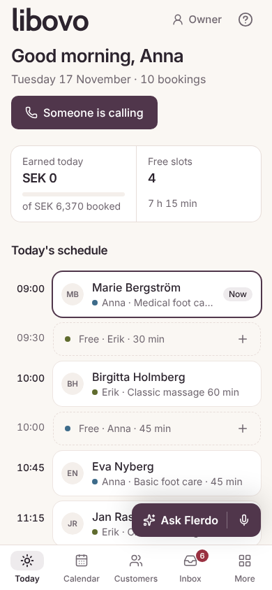 | Today, phone, dark 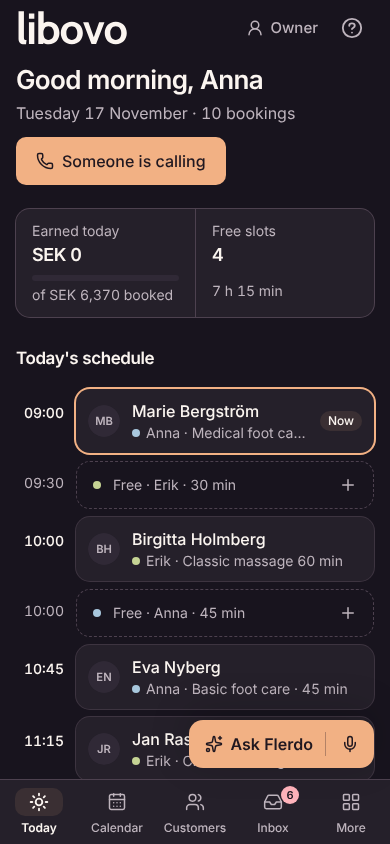 |
| Calendar at 320, light 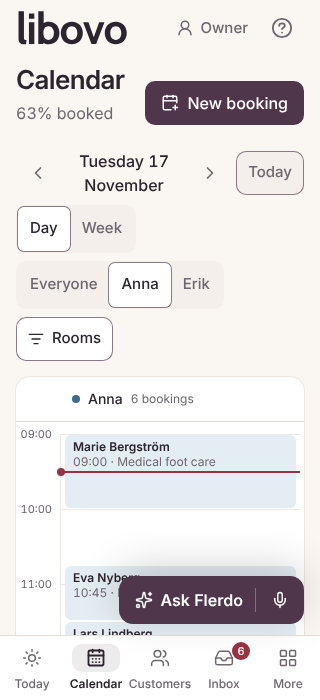 | Assistant proposal with Approve, dark 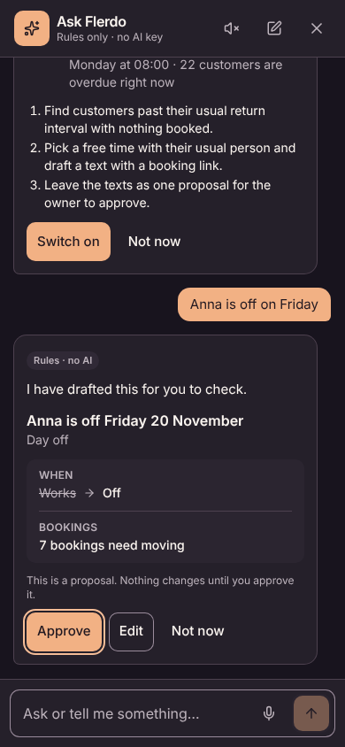 |
| Tenant page, OS light, studio pinned dark: Salong Eko's own green 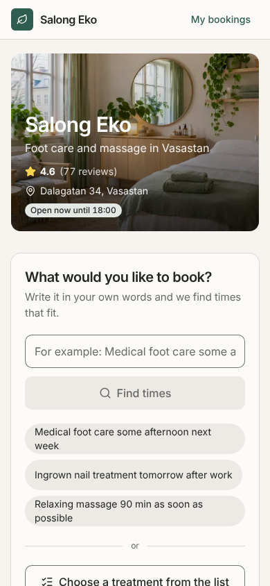 | Tenant without a palette, OS dark: neutral 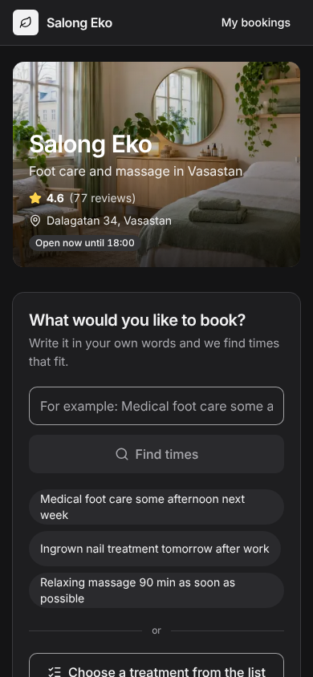 |
| Today, desktop, light (sidebar scrolls) 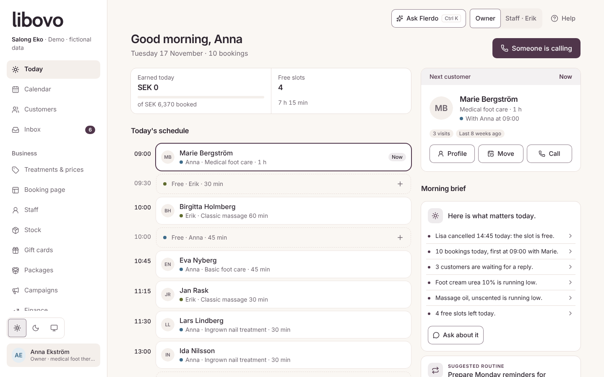 | Customers, desktop, dark 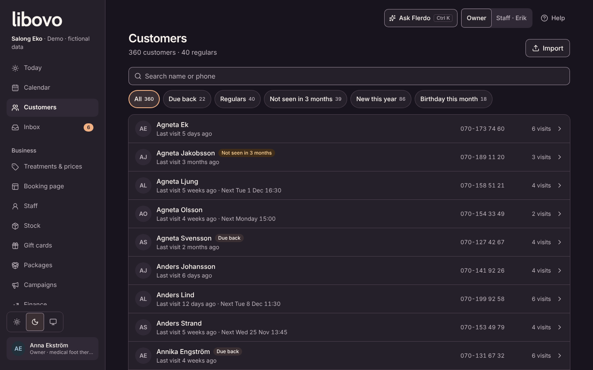 |
| Settings > Appearance, tablet, dark 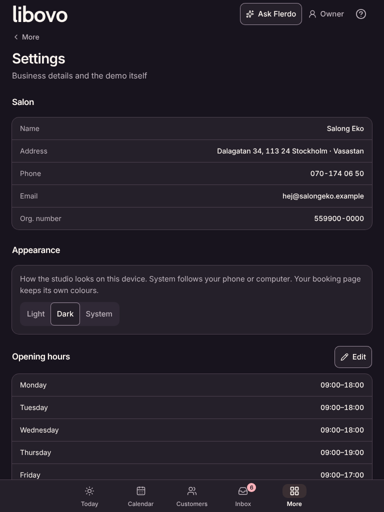 | Today at 200 % zoom on a 390 px phone 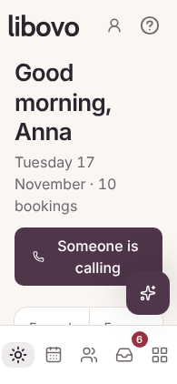 |
| Landing, dark, brand tokens 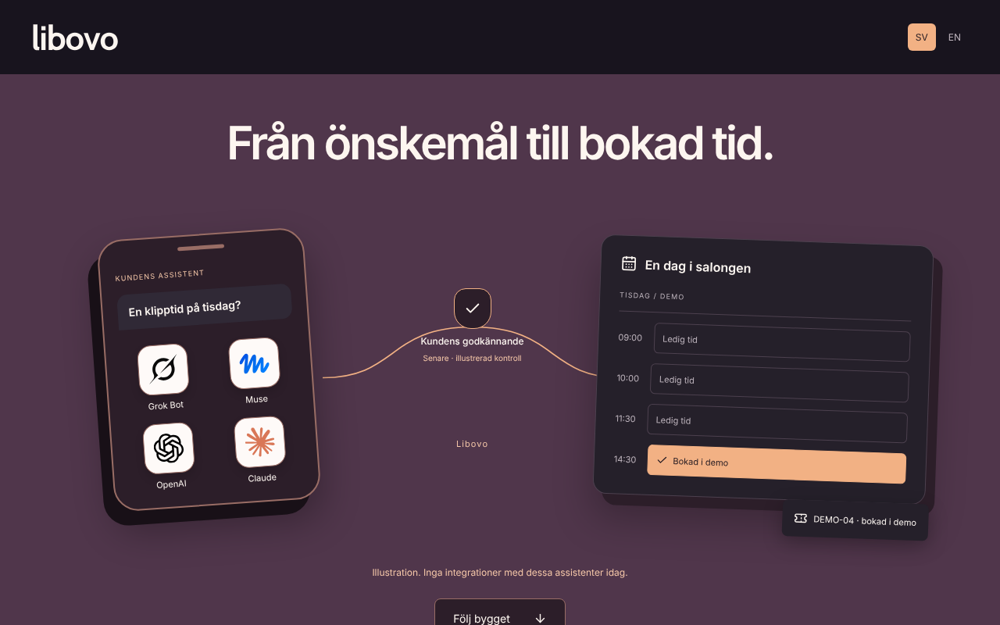 | |

Compared with `before/` and `after/`, the implementer's after shots match
what I saw. The one exception was the sidebar overlap in
`after/today-1440-light.png`, which is fixed now. All of `after/` and `qa/` were retaken after the Codex
fix round.

## Not verified

- Real devices: iOS Safari (auto-zoom on focus, safe-area insets with a home
  indicator, browser chrome colour), Android Chrome and installed PWA
  behaviour. All of this was headless Chromium with emulated widths,
  `hasTouch` and `prefers-color-scheme`.
- Screen readers (VoiceOver, TalkBack, NVDA). I checked only accessible
  names and roles through axe and Playwright.
- Firefox and WebKit (`light-dark()` support, `next/font` rendering).
- Wordmark kerning at 24, 40 and 80 px (a design review; the kit lists it as
  open).
- Behaviour with a real AI key (only rules mode was tested), and the
  database-backed pages beyond rendering and axe.
- Trademark and brand clearance (outside QA; the kit marks it as missing).
