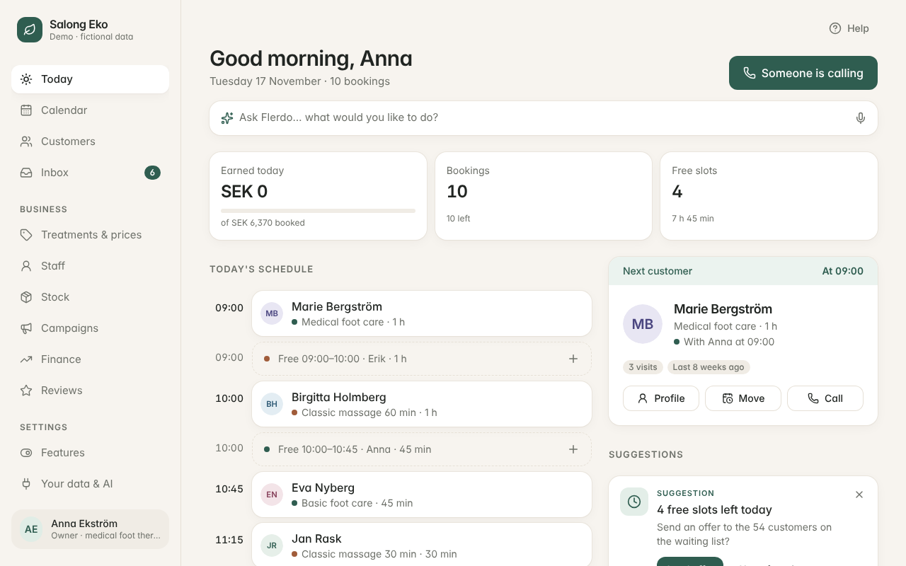
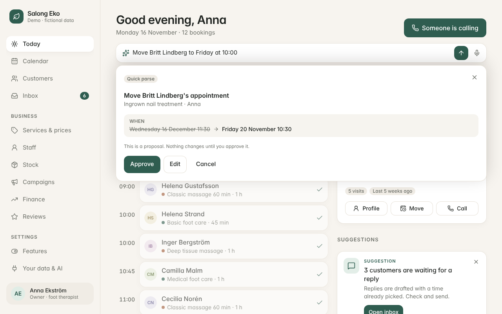
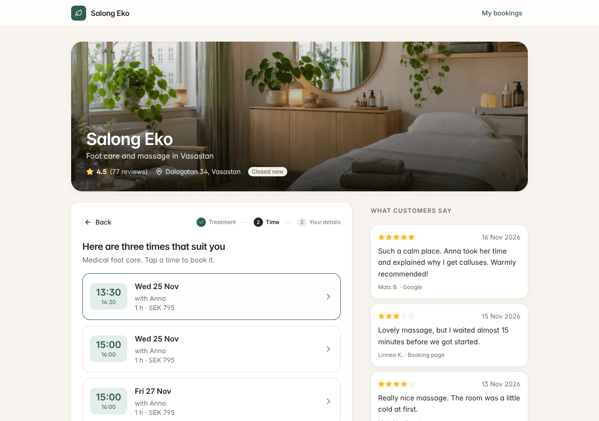
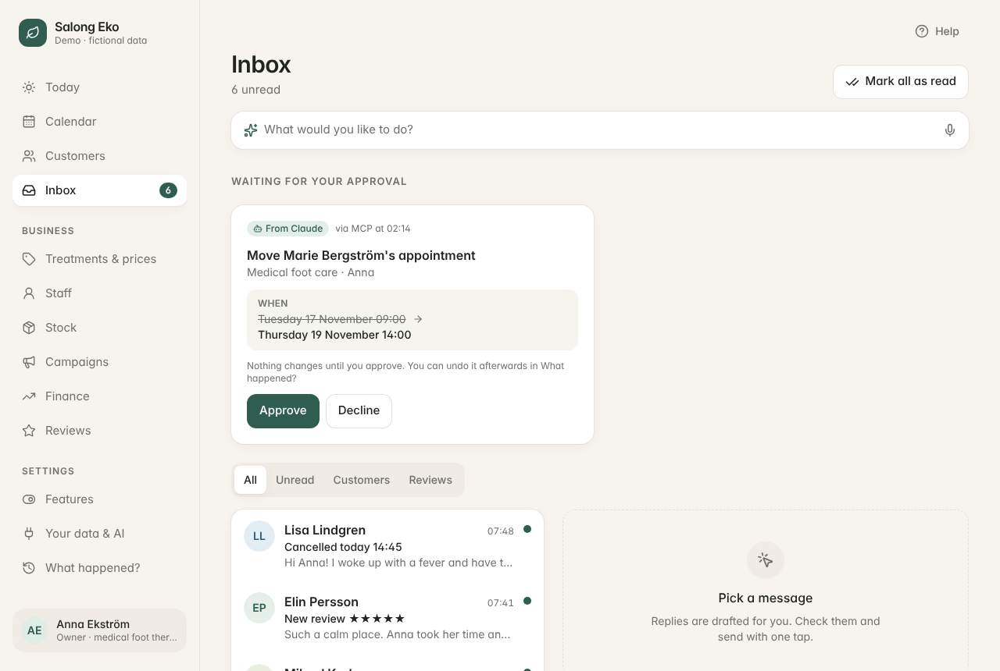

# Cresavo 0.2.0 – the first clickable concept

Cresavo was called Flerdo before November 2026.

> Release notes draft. Publish on GitHub as a pre-release with tag `v0.2.0` on commit 2e54a37 (concept/ai-native-demo) after Niclas approves.

**Cresavo 0.2.0 – the first clickable concept.** *Do more, click less.*

0.1.0 proved the booking engine: no double bookings, safe retries, and an agent API where the customer approves before anything is booked. 0.2.0 puts a product on top of it. It is a full owner studio and customer booking page where you say what you want, see exactly what will change, and approve with one tap.

Everything runs on fictional data in your browser. Nothing is sent, charged or published.

### What you can try
- **Assistant:** type or say "Move Britt to Friday at 10:30", "20% off massage all of March", "how busy is Erik next week?" or "sold a foot cream to Lena". You get a proposal with before/after, then Approve, and Undo afterwards.
- **Customer booking:** a first-time visitor writes "foot care some afternoon next week" and gets three times to choose from. It also covers My bookings, a waiting list, reviews, and an embeddable booking button.
- **Customers and journal:** a one-line summary per customer, voice journal with versions, return-visit reminders, segments and CSV import.
- **Campaign studio:** one offer gives copy for every channel plus posters, then Publish everywhere. Publishing and stats are simulated.
- **Stock and finance:** stock is used per treatment, forecasts and purchase lists come with it, and there is a one-screen finance overview with costs and SIE/CSV export.
- **Trust and support:** "What happened?" with Undo, trash, in-app help, and time-limited support access.
- **Modules and industry packs:** you pay only for what you switch on. Packs: foot care and massage, hair, nails, personal trainer, clinic.
- **Open protocols:** Claude and other agents read through MCP, A2A and USP. Their write tools only create proposals that wait in your Inbox.

### Not yet
Real login and roles, real messaging and payments, a real database for the studio, and a live AI key check. See the [pilot gate](../QUALITY_SECURITY.md) and open findings #14–#16.

### Next
Feedback from salon owners, followed by connecting the studio to the booking engine and working through the [pilot gate](../QUALITY_SECURITY.md).

Full list: [Changelog](../../CHANGELOG.md#020---2026-11-17)
