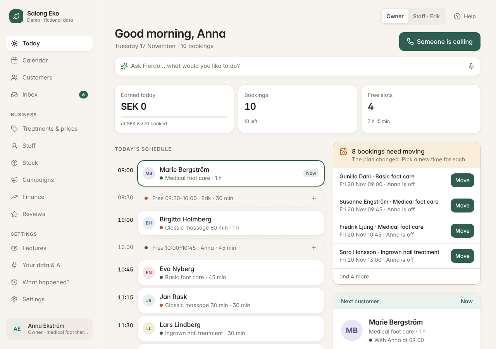
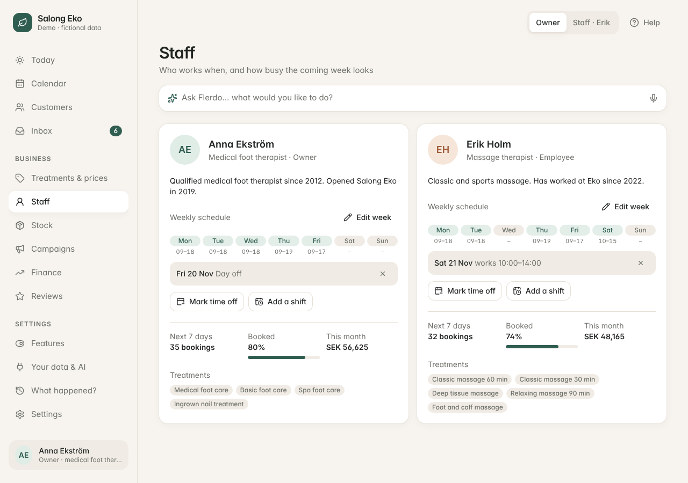
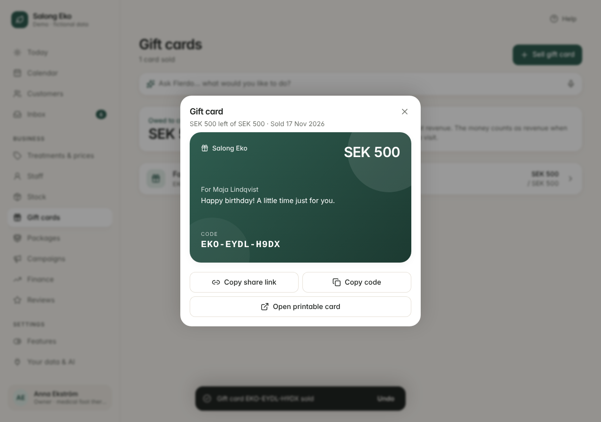
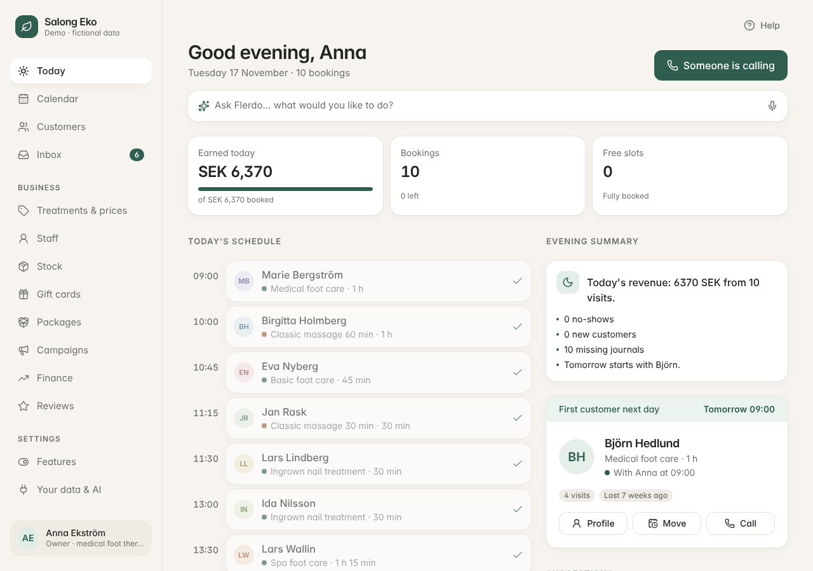

# Cresavo 0.3.0 – the real week

Cresavo was called Flerdo before November 2026.

> Release notes draft. Publish on GitHub as a pre-release with tag `v0.3.0` on
> the `chore(release): v0.3.0` commit of `concept/ai-native-demo` after Niclas
> approves. Image links below are relative to the repository.

0.2.0 showed the idea: say what you want, approve the proposal. 0.3.0 makes the
demo hold up through a real salon week. Opening hours, who works when, rooms,
gift cards and punch cards are all in, and the day ends with a summary.

Everything still runs on fictional data in your browser.

## New

- **Opening hours, closed days and holidays** in Settings, with Swedish public
  holidays suggested.
- **Staff schedules:** a weekly template plus time off and extra shifts.
- **Rooms:** rooms and chairs that cannot be double-booked.
- **One source of truth for free times:** the calendar, the customer page,
  "Someone is calling", return visits and AI agents always agree.
- **Say it:** "Anna is off on Friday", "close the salon on 24 December" and
  "Erik works Saturday 10–14" become proposals. Bookings that no longer fit show
  up on Today with a Move button. Nothing is moved or cancelled behind your back.
- **Owner and Staff view:** staff see their own day, the customers they serve
  and the journal. They do not see finance, settings or sales.
- **Gift cards:** sell, share or print them, pay a booking with one, and let
  customers check the balance online.
- **Packages:** for example "5 visits for the price of 4". A visit is used
  automatically when the booking is marked done.
- **Correct prepaid accounting:** gift cards and packages count as owed to
  customers until they are used.
- **Evening summary** after the last booking: revenue, visits, no-shows,
  missing journal notes and tomorrow's first customer.
- **Calendar feed per person** for Google or Apple Calendar. It shows no
  customer contact details.

## Better

- **Calmer layouts:** Today is calmer, the booking flow has one obvious next
  step, the calendar filters fit on one row on phones, and the due-back list is
  lighter.
- **Accessibility:** zero automated accessibility (axe) violations on every
  studio and booking page, and animations respect "reduce motion".
- **End-to-end tests:** seven journeys run on phone and desktop sizes:
  - online booking
  - command and undo
  - journal entry
  - campaign
  - agent proposal
  - day off
  - keyboard use

## Fixed

- Proposals from Claude and other agents (MCP) work again.
- Times like "at 14:30" keep their minutes.
- On phones, the command box is shorter and the mic button no longer covers
  other buttons.

## Behind the scenes

- **Product name:** the name lives in one constant, ready for the final name.
- **Open-source preparation:** Dependabot, a gitleaks secret scan of the full
  history and an OpenSSF Scorecard workflow.

## Not yet

Real login and roles, real messaging and payments, and a real database for the
studio. See the pilot gate in `docs/QUALITY_SECURITY.md` and open issues #14
and #18.

Full list: [CHANGELOG.md](../../CHANGELOG.md)
