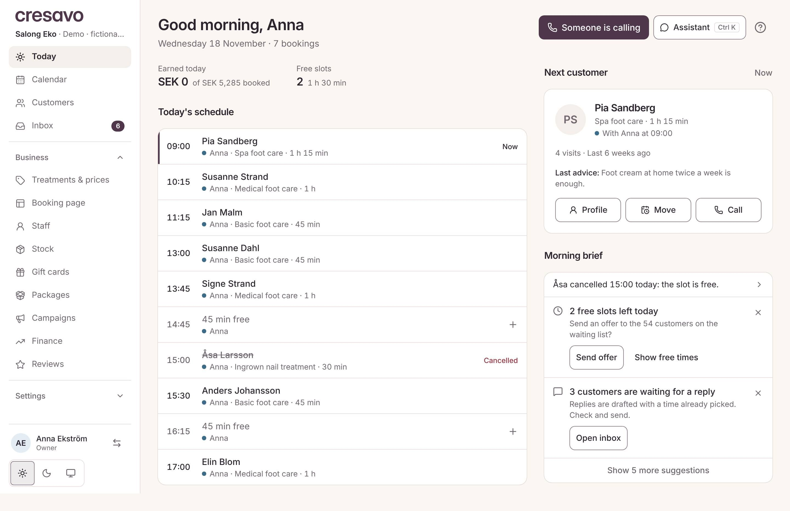

# Cresavo 0.4.0 – open source

> Pre-release. Concept demo with fictional data; not ready for real customers yet.

Cresavo started at home. Niclas's partner runs a salon from their house. Her booking platform gives her a hosted page and a calendar, but no open API, no way to take her own data with her, and no way to connect the website Niclas built for her. So he started building an open alternative, for her and for every salon that wants the same thing.

0.4.0 is the first release in the open: the code is public under AGPL-3.0, the demo runs at [demo.cresavo.com/studio](https://demo.cresavo.com/studio), and anyone can run it with three commands.



## New since 0.3.0

- **Open source.** A public repository with a security policy, code of conduct, contribution guide, issue templates and good first issues.
- **A name and a home.** Flerdo is now Cresavo, with [cresavo.com](https://cresavo.com) telling the story and the demo one click away.
- **The assistant, done properly.** A conversation panel (Ctrl+K / ⌘K) grounded in your data: answers, charts and proposals you approve or undo. Voice in and out. It works without any AI key ("Rules only"), and with a key it can use any OpenAI-compatible server, including a local one.
- **Bring your own AI.** Connect ChatGPT or Claude over MCP (see [Connect your AI assistant](../CONNECT_AI_ASSISTANT.md)). Every change is a proposal you approve.
- **Your booking page, your look.** Logo, colours with an automatic contrast check, fonts, sections in any order, your own address and, as a simulated module, your own domain. The page is white-label: no platform branding.
- **Treatments & prices.** Add, edit, hide and delete treatments and categories, and drag them into order. Every change can be undone.
- **Memory and routines.** The assistant remembers what you tell it, and suggests routines (overdue customers, low stock) that leave proposals, never silent changes.
- **Connections foundation.** One contract per capability (SMS, email, payments, accounting, calendar and more), with simulated adapters in the demo, so real providers can be plugged in later.
- **Light and dark**, calmer screens, 44 px touch targets and 200 % zoom support.
- Many fixes from independent reviews: undo integrity, gift cards and packages, staff scoping, AI request budgets and refund currency checks. See the [changelog](../../CHANGELOG.md).

## Try it

- In the browser: [demo.cresavo.com/studio](https://demo.cresavo.com/studio) (fictional salon, no sign-up).
- On your machine (Node.js 22.12+):

```bash
git clone https://github.com/Cresavo/cresavo.git
cd cresavo
npm run demo
```

## What's next

Real connectors (calendar, SMS, payments) behind the same contracts, bring-your-own-agent over remote MCP with per-agent permissions, and an English-speaking demo salon. Follow along in the [roadmap](../ROADMAP.md), and join the conversation in [Discussions](https://github.com/Cresavo/cresavo/discussions).

Previous release: [0.3.0](v0.3.0.md).
