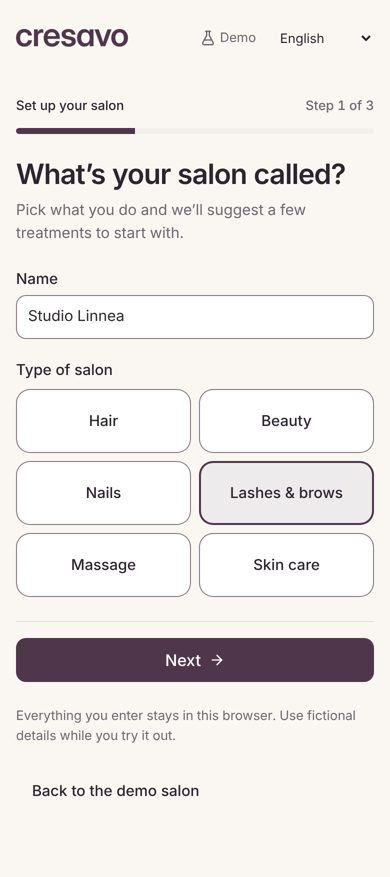
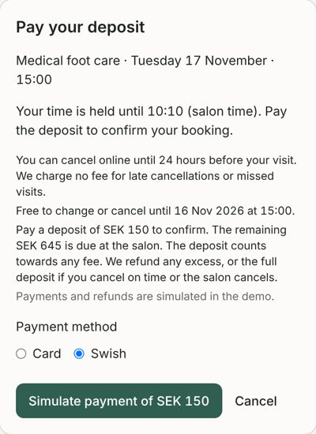

# Cresavo 0.5.0 – simple by default

> Pre-release. Concept demo with fictional data; not ready for real customers yet.

Salon owners told us the same thing over and over: booking systems are too complicated, and you are locked in. 0.5.0 is about the opposite. You can try Cresavo with your own salon in about two minutes, everything advanced stays out of the way until you want it, and your data is reachable by your own tools.



## New since 0.4.0

- **Your own salon in two minutes.** Name it, pick the type (hair, beauty, nails, lashes & brows, massage or skin care), adjust the suggested treatments, done. You land on your own booking page and a Today with a few example bookings. It only lives in your browser and is removed after 24 hours without use, or right away with Delete now.
- **Simple by default.** New salons start with every add-on switched off. Getting started is four short steps, and Today shows the next customer first.
- **Cancellation rules and deposits.** Set a free-cancellation window, fees for late cancellations and no-shows, and a deposit per treatment. Customers see the deadline and pay a simulated deposit by card or Swish before the time is confirmed. You decide on every fee, and refunds follow when the salon cancels.
- **Clearer booking.** Customers see the total, what is paid now and at the salon, and the exact cancellation deadline before they confirm. Book again sits next to Manage booking.
- **Connect your own AI assistant.** Pair ChatGPT or Claude with a fictional demo salon. The assistant can read the calendar and draft changes; nothing happens until you approve it in the Inbox.
- **English and Swedish.** The studio, the demo salon and the help articles follow your language, and there is a Swedish product site at [cresavo.com/sv](https://cresavo.com/sv).
- **One look everywhere.** A new design-system foundation with shared components, calm motion that respects reduced-motion settings, and accessibility checks.
- **Open by design.** Every feature now declares how it is reachable through the API, as the first step towards building your own website or dashboard on your Cresavo data. See the [API platform plan](https://github.com/Cresavo/cresavo/blob/main/docs/design/API_PLATFORM.md).
- Many fixes, including five of the good first issues. See the [changelog](https://github.com/Cresavo/cresavo/blob/main/CHANGELOG.md).



## Try it

- In the browser: [demo.cresavo.com/studio](https://demo.cresavo.com/studio). Choose **Start with your own salon**.
- On your machine (Node.js 22.12+):

```bash
git clone https://github.com/Cresavo/cresavo.git
cd cresavo
npm run demo
```

## Follow along

Watch the repository and choose **Custom → Releases** to get one notification per release, or subscribe to the [releases feed](https://github.com/Cresavo/cresavo/releases.atom). Ideas and questions are welcome in [Discussions](https://github.com/Cresavo/cresavo/discussions).
