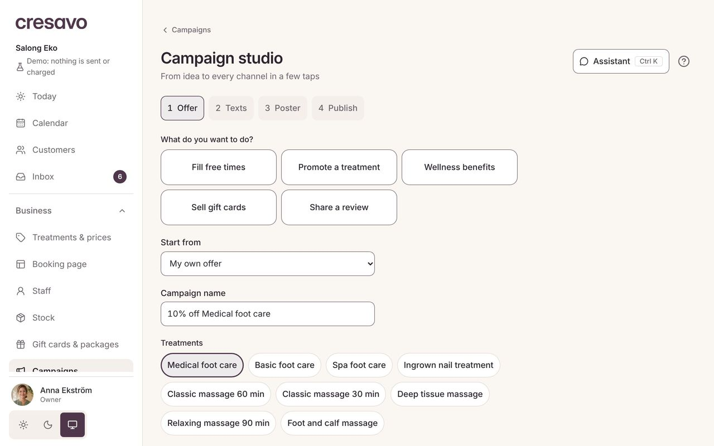
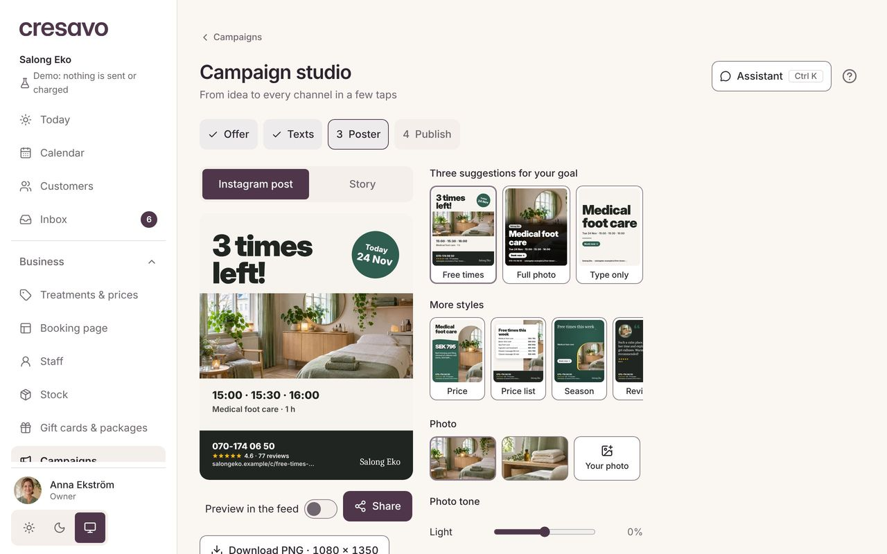
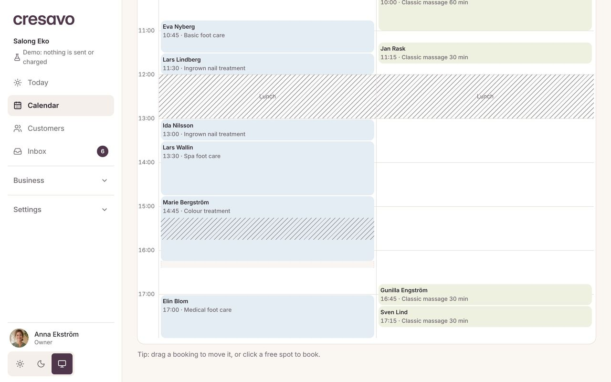

# Cresavo 0.6.0 – marketing that looks like your salon

> Pre-release. Concept demo with fictional data; not ready for real customers yet.

Salon owners told us marketing is the part they dread most: finding a picture, writing the text, making it look good on Instagram. 0.6.0 starts from what you want to achieve and turns it into a poster and texts that look like *your* salon, with your own photos, colours and voice. Behind the scenes, this release also lays the groundwork for running real salons: hairdresser timing, customer import and much stricter checks on every change.



## New since 0.5.0

- **Start a campaign from a goal.** Fill free times, promote a treatment, wellness benefits, sell gift cards or share a review. The goal fills in the offer and dates, and suggests three posters with different compositions.
- **Posters that stay beautiful whatever you type.** A new poster engine draws designed templates with fixed slots: Price, Price list, Season, Review, Free times, Before/after, Portrait, Full photo and Type only. Your salon's colours and heading font are used everywhere, text is measured with the real fonts so it never runs off the poster, and Instagram story safe zones are respected. Adjust light, contrast and warmth, pick a mirrored layout, add the wellness benefits you accept (Epassi, Benify and others) and a QR code to your booking page.
- **Captions in your own voice.** The texts follow the campaign's goal, and Cresavo learns your hashtags, emoji habit and length from your published campaigns. Add a sign-off once and it is used wherever it fits (never in an SMS).
- **Preparation, clean-up and processing time.** Treatments can have time before and after the visit when you are busy, and a processing gap, for example colour developing, where you can take another customer's short treatment. Every booking keeps the timing it was booked with, so editing a treatment later never makes existing visits overlap. The calendar shows the gap striped, and you can tap it to book.
- **Bring your customers with you.** Import a CSV export from your current system, in Swedish or English column names, including files saved by older Swedish systems and Excel. Duplicates by phone or e-mail are skipped, imported customers never get marketing consent, and the whole import can be undone in one step.
- **Stricter checks on every change.** Every change made in the studio is validated field by field on the server, ids can no longer collide, and several booking rules are now enforced on the server too (a booking can only move to someone who does the treatment, journal notes must belong to the right customer).
- **Groundwork for real salons (off by default).** Owner accounts, a server-side salon store with history and exactly-once effects, and a public booking page that reads a real salon's free times without exposing customers. Online booking for real salons comes in the next releases.





## Try it

- In the browser: [demo.cresavo.com/studio](https://demo.cresavo.com/studio). Open **Campaigns** and pick a goal.
- On your machine (Node.js 22.12+):

```bash
git clone https://github.com/Cresavo/cresavo.git
cd cresavo
npm run demo
```

The full list of changes is in the [changelog](https://github.com/Cresavo/cresavo/blob/main/CHANGELOG.md).

## Follow along

Watch the repository and choose **Custom → Releases** to get one notification per release, or subscribe to the [releases feed](https://github.com/Cresavo/cresavo/releases.atom). Ideas and questions are welcome in [Discussions](https://github.com/Cresavo/cresavo/discussions).
